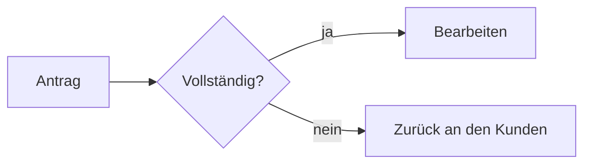

# Anleitung für Anwender

Mit PTA Documents schreibst du einen Bericht oder eine Präsentation als Markdown-Text und
bekommst daraus ein Word-Dokument oder eine PowerPoint-Präsentation **auf den offiziellen
PTA-Vorlagen** — mit Deckblatt, Logo, Kopf- und Fußzeile, PTA-Formatvorlagen und PTA-Layouts.
Umgekehrt macht es aus vorhandenen Word- und PowerPoint-Dateien Markdown.

PDF gibt es auch: `./run.sh generate bericht.md --pdf` schreibt ein PDF/A in den
Formatvorlagen der PTA-Word-Vorlage, mit Deckblatt, Inhaltsverzeichnis, Kopf- und Fußzeile wie
in Word; Charts, Mermaid-Diagramme, Zeitstrahl, Schrittfolge und Risikomatrix zeichnet es als
scharfe Vektorgrafik, Gantt als Tabelle, Icons wie Word. Ein Zeichen, das der Schrift fehlt
(etwa ein Emoji oder Griechisch), erscheint als `?` — `check --pdf` nennt es.

## 1. Einmal einrichten

Du arbeitest direkt in einem Klon dieses Repos. Voraussetzung ist Python 3.12 oder neuer.

```sh
git clone <repo-url> pta-documents
cd pta-documents
./run.sh setup          # unter Windows: .\run.ps1 setup
```

Für Mermaid-Diagramme (siehe Abschnitt 5) muss vorher Node.js (ab Version 22) installiert sein;
`./run.sh setup` richtet dann mermaid-cli mit ein. Ohne Node.js geht alles andere genauso.

Ob alles läuft, zeigt das Beispiel zum Hauptbeskidenweg:

```sh
./run.sh generate samples/gsb --out documents/gsb
```

Danach liegen `gsb-bericht.docx` und `gsb-praesentation.pptx` in `documents/gsb/`. Die
Markdown-Dateien in `samples/gsb/` sind die beste Vorlage für eigene Dokumente; alles, was
die Generatoren können, zeigt `samples/funktionen/`
(`./run.sh generate samples/funktionen --out documents/funktionen`). Sie ist das
Nachschlagewerk: Der Word-Bericht `funktionen-bericht.docx` zeigt zu jeder Funktion den
Markdown-Quelltext und darunter das Ergebnis, die Präsentation hat den Quelltext jeder Folie in
deren Notizen. Nach `./run.sh test` liegen alle diese Dokumente auch in `.tmp/review/funktionen/`.

Später holst du Neuerungen mit `git pull` und danach einmal `./run.sh setup`.

## 2. Eigene Dokumente erzeugen

Eigene Dokumente gehören in den Ordner **`documents/`** — git ignoriert ihn, nichts davon landet
im Repo, und `git pull` stört ihn nicht. Ein Thema, ein Ordner:

```
documents/statusbericht-q3/
  statusbericht-bericht.md        → Word
  statusbericht-praesentation.md  → PowerPoint
  images/                         → Bilder (PNG, JPEG, GIF, SVG)
```

```sh
./run.sh generate documents/statusbericht-q3
```

Word und PowerPoint entstehen neben den Markdown-Dateien. Die Endung des Dateinamens wählt das
Format: `…-bericht.md` oder `…-dokument.md` → Word, `…-praesentation.md` oder `…-folien.md` →
PowerPoint. Andere Namen gehen mit `--docx` bzw. `--pptx`; `--out <ordner>` schreibt woanders hin;
statt eines Ordners kann man auch einzelne Dateien angeben. Bilder werden relativ zur
Markdown-Datei angegeben: ``.
SVG-Grafiken (`images/plan.svg`) gehen auch: Word und PowerPoint zeigen sie scharf in jeder
Größe (ältere Office-Versionen ein Bild in doppelter Auflösung). Das SVG braucht eine Größe
(`width`/`height` oder `viewBox`); Verweise auf andere Dateien oder Web-Adressen darin werden
nicht geladen, und Text erscheint in der PTA-Schrift.

Ein Fehler in einer Datei wird gemeldet, die anderen Dateien werden trotzdem erzeugt.

### Prüfen, bevor man erzeugt

```sh
./run.sh check documents/statusbericht-q3
```

schreibt nichts, meldet aber dieselben Fehler und Hinweise wie `generate` und dazu
**Stilhinweise** nach den Regeln der PTA-Musterfolien — zu viele Punkte oder Wörter auf einer
Folie, Fließtext in Aufzählungen, gemischte Satzzeichen am Ende der Punkte, zu lange Folientitel,
Bilder ohne Alt-Text, in Word Überschriften mit eigener Nummer; liegt eine `QUELLEN.md` im
Ordner, auch Bilder ohne Urheber. Darunter steht eine kurze Statistik:

```
OK documents/statusbericht-q3/statusbericht-praesentation.md
  - line 14: The slide "Kosten" has 95 words, more than 80. Shorten it, split it, or move details into the speaker notes (::: notes). [style-words]
  12 slides: 1 title, 3 chapters, 7 content (0 continued), 1 closing
  480 words, per content slide 20/45/95 (min/median/max), 0 in notes; about 14 minutes (…)
```

Die Dauer ist bewusst grob (2 Minuten je Inhaltsfolie) — sie soll 60 Folien für 30 Minuten
auffallen lassen. Für Word gibt es Wörter, Tabellen, Abbildungen und eine grobe Seitenzahl.
Eine Regel, die für eine Datei nicht passt, schaltet `pruefung: style-words` im Kopf ab
(`pruefung: aus` alle) oder `--skip style-words` für einen Lauf. Alle Codes und Grenzen:
[verwendung.md](verwendung.md#prüfen-ohne-erzeugen-check).

## 3. Der Kopf des Dokuments (Front Matter)

Ganz oben, zwischen zwei Zeilen `---`, stehen Angaben zum Dokument — je Zeile `schlüssel: wert`.
Werte mit Doppelpunkt in Anführungszeichen setzen. Ja/Nein heißt `ja`/`nein`, ein Datum
`2026-11-06` oder `06.11.2026`.

```markdown
---
titel: Statusbericht Projekt Nordlicht
untertitel: Quartal 3
autor: Erika Muster
ort: Hamburg
datum: 2026-11-06
---
```

| Schlüssel | Word | PowerPoint | Bedeutung |
| --------- | :--: | :--------: | --------- |
| `vorlage` | ✓ | ✓ | Word: `hoch` (Standard), `hoch-ohne-deckblatt`, `quer`, `quer-ohne-deckblatt`. PowerPoint: `basis` (Standard), `schulung` |
| `titel` | ✓ | ✓ | Titel; in Word mit Deckblatt Pflicht |
| `untertitel` | ✓ | ✓ | Untertitel |
| `autor`, `ort`, `datum` | ✓ | ✓ | Zeile „Autor, Ort, Datum" auf Deckblatt bzw. Titelfolie |
| `firma` | ✓ | | ersetzt „PTA IT-Beratung" in der Word-Fußzeile |
| `inhaltsverzeichnis` | ✓ | | `ja`: Inhaltsverzeichnis nach dem Deckblatt |
| `sprache` | ✓ | ✓ | `de` (Standard) oder `en` — z. B. „Page"/„Table"/„Figure", englisches Logo auf der Titelfolie (auch in der Schulungsvorlage) |
| `fusszeile` | | ✓ | Text der Fußzeile „PTA – …" (sonst der Titel) |
| `titelfolie` | | ✓ | `bild-02` (Standard), `bild-01`, `branchen`, `ohne-bild` |
| `kennzeichnung` | ✓ | ✓ | `vertraulich` („VERTRAULICH"), `intern` („Für den internen Gebrauch"), `entwurf` („ENTWURF"), `kein`. Folien: Sticker oben rechts auf jeder Folie; Standard `basis` ohne, `schulung` `intern` — dort ist `kein` nicht erlaubt. Word und PDF: Text in Blau unter dem Logo jeder Seite und auf dem Deckblatt, `entwurf` zusätzlich ein Wasserzeichen „ENTWURF" quer über jede Seite; Standard `kein`. Ein Entwurf, der an den Kunden geht, trägt das sichtbar — vor dem Versand auf `kein` (oder `vertraulich`) stellen |
| `typografie` | ✓ | ✓ | `ja` (Standard) oder `nein`: Anführungszeichen, Gedankenstriche, geschützte Leerzeichen (siehe unten) |
| `syntaxhervorhebung` | ✓ | ✓ | `ja` (Standard) oder `nein`: Codeblöcke mit Sprache farbig |
| `pruefung` | ✓ | ✓ | nur für `./run.sh check`: `aus` schaltet die Stilregeln ab, `style-words, style-title` nur diese |
| `aufbau` | | ✓ | `listen`: jede Liste erscheint beim Vortragen Punkt für Punkt (siehe [Klick für Klick](#klick-für-klick)); `nein` (Standard) |
| `uebergang` | | ✓ | Übergang jeder Folie: `none` (Standard), `fade`, `push`, `wipe`, `morph` … (siehe [Folienübergänge](#folienübergänge)) |

Ein falscher Schlüssel oder Wert bricht mit einer Meldung ab, die die gültigen Werte nennt.

**Typografie:** Gerade Anführungszeichen schreiben, die Typografie macht den Rest. Beim
Erzeugen wird `"so"` zu „so“, `'so'` zu ‚so‘, `geht's` zu geht’s, ` - ` (mit Leerzeichen) zu
einem Gedankenstrich –, `...` zu …; in `z. B.`, `u. a.`, `d. h.`, `Nr. 3`, `S. 12`, `§ 5`,
`10 %`, `5 km`, `3 Mio.` und `1. Januar` kommt ein geschütztes Leerzeichen, damit dort keine
Zeile umbricht. Code (`` `so` `` und Codeblöcke), Links und der Kopf bleiben, wie sie
geschrieben sind. Mit `sprache: en` gibt es “englische” Anführungszeichen und keine deutschen
Abkürzungen. Wer gerade Zeichen will, schreibt `typografie: nein`.

**Code:** Ein Codeblock mit Sprache (```` ```python ````, ```` ```csharp ````, ```` ```sql ````
…) wird im PTA-Schema farbig. Ohne Sprache bleibt er einfarbig; eine unbekannte Sprache meldet
der Generator als Hinweis `code-language-unknown`.

## 4. Word-Bericht schreiben

| Du schreibst | Im Word-Dokument |
| ------------ | ---------------- |
| `# Kapitel` | Überschrift 1 (nummeriert 1, 2, 3 …) |
| `## Abschnitt`, `### Unterabschnitt` | Überschrift 2 und 3 (1.1, 1.1.1) |
| `#### Zwischentitel` | Zwischenüberschrift (Versalien, ohne Nummer) |
| normaler Absatz | Standard |
| `**Absatz nur fett**` | Standard fett — direkt vor einer Tabelle ist das ihr Titel |
| `- Punkt` (eingerückt bis 3 Ebenen) | PTA-Aufzählung (■, dann ―) |
| `1. Schritt` | nummerierte Liste, jede Liste beginnt wieder bei 1 |
| Tabelle mit `\|` | Tabellenformat „PTA" (blauer Kopf) |
| `Tabelle: Text` direkt unter der Tabelle | Beschriftung „Tabelle 1: Text" |
| Bild allein im Absatz | Bild in Satzspiegelbreite, darunter „Abbildung 1: …" aus dem Bildtitel (in `"…"`) oder dem Alt-Text |
| `` | QR-Code in PTA-Blau, 3 × 3 cm, mit „Abbildung n: …"; `{scale=0.5}` nach dem Bild halbiert ihn (siehe [QR-Codes](#qr-codes)) |
| `{.round}`, `{.grey}`, `{scale=0.5}` | rundes Bild, Graustufenbild, halbe Größe (siehe [Bildausschnitt und Bildstile](#bildausschnitt-und-bildstile)) |
| `::: timeline` mit `- 2026-03: Text` | Zeitstrahl als Bild in Satzspiegelbreite (siehe [Zeitstrahl und Projektplan](#zeitstrahl-und-projektplan)) |
| `::: gantt` mit Tabelle Vorgang, Start, Ende (, Wer) | Projektplan als Tabelle mit schattierten Monats-/Wochenspalten |
| `::: steps` mit einem `###` je Schritt | Schrittfolge als Pfeile, Bild in Satzspiegelbreite (siehe [Schrittfolge, Bewertung und Risiken](#schrittfolge-bewertung-und-risiken)) |
| `[3/4]` allein in einer Tabellenzelle | Harvey Ball ◕ in PTA-Blau |
| `::: riskmatrix` mit Tabelle Nr, Risiko, Wahrscheinlichkeit, Auswirkung (, Maßnahme) | 5 × 5-Risikomatrix als Bild, darunter die Legende als Tabelle |
| `:icon-check:` im Text oder vor jedem Listenpunkt | Icon in PTA-Blau im Text bzw. statt des Aufzählungszeichens (siehe [Icons](#icons)) |
| ```` ``` ```` Codeblock | Formatvorlage Code (Consolas, grau hinterlegt) |
| ```` ```chart ```` mit Einstellungen und CSV | echtes Word-Diagramm über die Textbreite, darunter „Abbildung n: …" aus `title` (siehe [Diagramme aus Daten](#diagramme-aus-daten)) |
| ```` ```mermaid ```` oder ```` ```financial-chart ```` | scharfes Bild in natürlicher Größe, höchstens über die Textbreite (siehe [Diagramme mit Mermaid](#diagramme-mit-mermaid), [Finanzdiagramme](#finanzdiagramme)) |
| `Abbildung: Text` direkt unter einem solchen Codeblock | Beschriftung „Abbildung n: Text" (geht dem `title` eines Charts vor) |
| `> Zitat` | eingerücktes Zitat |
| `[Text](https://…)` | Hyperlink |
| `Text[^1]` und `[^1]: Erklärung` | Word-Fußnote |
| `**fett**`, `*kursiv*`, `~~durch~~`, `` `code` `` | entsprechend formatiert |

Der Titel kommt **nur** aus dem Front Matter — `#` ist immer ein Kapitel.

## 5. Präsentation schreiben

```markdown
# Titel der Präsentation        ← Titelfolie (das erste #)

# Erstes Kapitel                ← Trennfolie „01"

## Folientitel                  ← eine Folie

Einleitender Satz.              ← Textebene „Einleitungstext"

- Aufzählung                    ← Aufzählungsebenen (bis 3 tief)

### Zwischenzeile               ← Textebene „Subheadline"

# Danke! {.closing}             ← Abschlussfolie
```

- Unter einem Kapitel-`#` und unter der Abschlussfolie darf **kein Inhalt** stehen — die
  PTA-Layouts haben dort keinen Platz. Inhalt gehört unter `##`.
- Eine **Tabelle**, ein **Codeblock** oder **mehrere Bilder** bekommen eine eigene Folie; Text
  davor steht oben, Text danach unten. Ein fetter Absatz direkt vor der Tabelle wird ihre
  Titelzeile.
- **Ein Bild mit Text** kommt auf das Layout „Titel, Text und Bild 01", ein Bild allein auf
  „Titel und Bild 01" — das Bild wird auf den Rahmen zugeschnitten, um die Mitte oder den
  Punkt aus `{focus=…}` (siehe [Bildausschnitt und Bildstile](#bildausschnitt-und-bildstile)). Ein QR-Code
  (``) wird dagegen eingepasst, nie beschnitten (siehe [QR-Codes](#qr-codes)).
- **Bestimmtes Layout:** `## Folie {layout="Titel und Text (zweispaltig)"}`. Der Inhalt wird an
  Zeilen `---` auf die Textfelder verteilt (links, rechts). Der Name muss genau stimmen; bei einem
  Tippfehler listet die Meldung alle 35 Layouts.
- **Zu viel Inhalt** wird bis 12 pt verkleinert; reicht das nicht, geht es auf einer Folie
  „… (Forts.)" weiter. Besser: kurze Folien schreiben.
- Text vor dem ersten `#` wird ignoriert. Fotos brauchen ihren Urheber auf der Folie, wenn die
  Lizenz das verlangt (siehe `samples/gsb/`).

### Sprechernotizen

Was der Vortragende zu einer Folie sagt, steht in einem Block `::: notes` unter ihrer
Überschrift. PowerPoint zeigt ihn in der Notizenansicht (auf dem Notizenmaster der PTA-Vorlage),
Word lässt ihn weg (mit dem Hinweis `notes-dropped`). Ein Codeblock in den Notizen bleibt Zeile
für Zeile in Consolas erhalten; enthält er selbst `:::`-Zeilen, braucht der Notizblock einen
längeren Zaun (`:::: notes` … `::::`).

```markdown
## Ergebnis des Quartals

- Umsatz +4 %

::: notes
Zuerst die gute Nachricht nennen, dann **kurz** auf den Süden eingehen.

- Zahlen sind vorläufig
:::
```

- Gilt für jede Überschrift, auch für Titel-, Trenn- und Abschlussfolie (dort ist er der einzige
  erlaubte Inhalt). Mehrere Blöcke einer Überschrift werden zusammengefügt; wird eine Folie
  geteilt („Forts.") oder macht ihre Überschrift mehrere Folien, steht der Sprechtext auf jeder.
- In Notizen bleiben Absätze, Listen, fett, kursiv, Code und Links erhalten; Tabellen, Bilder und
  Codeblöcke darin werden ohne Fehler weggelassen.
- Ein `::: notes` vor der ersten Überschrift ist ein Fehler.
- Faustregel: zu jeder Folie zwei bis fünf Sätze Sprechtext.

### Klick für Klick

Eine Zeile `{.build}` direkt vor einer Liste lässt ihre Punkte beim Vortragen einzeln
erscheinen, jeden mit einem Klick (sanft eingeblendet). Vor Karten (`::: cards`), Zeilen
(`::: rows`), Spalten (`::: columns`) und einer Reihe von Bildern erscheint so ein Element nach
dem anderen; vor einer Tabelle, einem Codeblock, einem Diagramm oder einem Absatz der ganze
Block. `{.frag}` zeigt den nächsten Block immer als Ganzes. Word und PDF zeigen alles wie ohne
die Zeile.

```markdown
## Unser Vorschlag

{.build}
- Erst das Problem
- dann die Lösung

{.frag=fly}
| Phase | Dauer |
| ----- | ----- |
| Analyse | 4 Wochen |
```

- Statt des Einblendens: `{.build=appear}` (erscheint sofort), `=fly` (fliegt von unten herein),
  `=wipe` (wird von unten aufgedeckt); dasselbe mit `{.frag=…}`.
- `{.exit}` vor einem Block: er steht von Anfang an da und verschwindet beim Klick.
  `{.emphasize}` vor Text (Absatz, Liste): er wird beim Klick PTA-blau.
- `aufbau: listen` im Kopf lässt jede Liste der Präsentation so erscheinen.
- Die Zeile steht für sich (mit oder ohne Leerzeile davor und danach). Ein falscher Name, ein
  Marker ohne Block danach oder vor einer Folienüberschrift ist ein Fehler mit Zeilennummer. Auf
  Titel-, Trenn- und Abschlussfolie und auf Agenda, Zwischenfazit, Zitat und Kontakt gibt es
  keine Builds.
- Die Folie wird beim Klicken in der Reihenfolge des Markdowns aufgebaut; wird sie geteilt
  („Forts."), baut jeder Teil seine Inhalte.

### Folienübergänge

Ohne Angabe wechseln die Folien sofort. `uebergang: fade` im Kopf blendet jede Folie über;
`{uebergang="…"}` am Ende einer Überschrift gilt an einem `#` für die Trennfolie und alle
Folien des Kapitels, an einem `##` nur für diese Folie (auch für ihre „Forts."-Folien).

```markdown
# Ausgangslage {uebergang="fade"}

## Was sich geändert hat {uebergang="push-up"}
```

| Wert | Wirkung |
| ---- | ------- |
| `none` | kein Übergang (Standard); so schaltet man ihn für eine Folie ab |
| `fade` | Überblenden |
| `push`, `push-left`, `push-right`, `push-up`, `push-down` | die neue Folie schiebt die alte in diese Richtung hinaus (`push` = nach links) |
| `wipe`, `wipe-left`, `wipe-right`, `wipe-up`, `wipe-down` | die neue Folie wird in diese Richtung aufgedeckt (`wipe` = nach links) |
| `split` | öffnet sich von der Mitte aus |
| `cover`, `uncover` | schiebt sich über die alte bzw. die alte gleitet weg |
| `zoom` | wächst aus der Mitte |
| `cut` | harter Schnitt, wie ohne Übergang |
| `morph` | PowerPoint 2019/365: gleichnamige Formen gleiten an ihren neuen Platz, der Rest blendet über; ältere Programme und LibreOffice blenden über |

Ruhig bleiben: ein Übergang für das ganze Deck oder ein Kapitel, nicht auf jeder Folie ein
anderer. Ein falscher Wert ist ein Fehler mit Zeilennummer, der die gültigen Werte nennt; Word
und PDF ignorieren das Attribut, `uebergang` im Kopf eines Word-Berichts ist ein Fehler.

### Folien-Syntax

Mit einer eigenen Syntax werden aus einer `##`-Folie **Flow-Folien** im PTA-Stil. PowerPoint
zeichnet sie auf dem Layout `Nur Titel`; Word nimmt dieselbe Syntax an und zeigt sie schlicht:
Container-Inhalte nacheinander (Karten- und Spaltenüberschriften fett statt als Überschrift),
Hinweiskästen, Fazit- und Kommentarbox als graue Absätze mit farbiger Linie links und fetter Art
am Anfang („Hinweis:", „Fazit:"), `==Markierung==` gelb hinterlegt, farbige Wörter und
Status-Labels in der Statusfarbe, mehrere Bilder in einem Absatz nebeneinander, jedes mit seiner
Beschriftung.

```markdown
## Warum neu bauen? {kicker="Warum"}

::: cards
### Zu kompliziert
**26 Tabellen**

für 12 Arten von Regeln.

### Zu langsam
**3,2 GB**

Speicher je Fahrplan.
:::

::: conclusion
Ein Neubau ist günstiger als jede weitere Erweiterung.
:::
```

- Container `::: name` … `:::` (verschachtelt mit längeren Zäunen, `::::` außen):
  `cards` (Karten nebeneinander, je eine `###`-Überschrift, darunter optional eine fette
  Kennzahl, oder eine Liste `- **Titel** – Text`), `rows` (eine Liste `- **Begriff** –
  Beschreibung`), `panel` bzw. `panel dark` (graue bzw. dunkelblaue Fläche), `statement` (der
  erste Absatz groß), `columns` bzw. `columns 1:2` (Spalten, getrennt durch eine Zeile `---` mit
  Leerzeile davor), `conclusion` (die PTA-Fazit-Box am Fuß der Folie, höchstens zwei Zeilen,
  einmal je Folie) und `comment` (die PTA-Kommentarbox, eine Sprechblase rechts oben auf dem
  Block davor, z. B. einem Diagramm).
- Hinweiskästen `> [!NOTE]`, `[!TIP]` (Balken PTA-Blau), `[!IMPORTANT]`, `[!WARNING]`,
  `[!CAUTION]` (Balken Gelb); ein Absatz aus Code-Spans `` `a` `b` `` wird zu Chips.
- `==Markierung==` ist fett auf PTA-Gelb (auf allen Folien); eine Tabellenzeile, deren erste
  Zelle ganz markiert ist, steht auf Gelb.
- Farbige Wörter `[im Plan]{.success}` (`.warning`, `.danger`, `.info`, `.neutral`) sind fett
  in der Signalfarbe; im Front Matter `status.success: Erledigt` usw. — eine Tabellenzelle, die
  nur `` `Erledigt` `` enthält, bekommt auf Flow-Folien einen Ampelpunkt „●" in dieser Farbe.
- An `##`-Überschriften: `{kicker="Warum"}` (kleine Zeile über dem Titel) und `{.dark}` (Folie
  auf dem Verlauf der Titelfolie, Schrift weiß).
- Genau zwei gleich breite Spalten nur mit Text kommen auf das Vorlagenlayout
  `Titel und Text (zweispaltig)`.
- Passt eine Flow-Folie nicht, wird alles bis zu zweimal um ein Achtel kleiner (nie unter
  12 pt), dann geht es auf einer Folie „(Forts.)" weiter; Karten, Flächen und Spalten werden
  nicht geteilt, die Fazit-Box steht auf der letzten.

Ein Tippfehler oder ein falscher Aufbau (z. B. eine Karte ohne `###`) ergibt eine
Fehlermeldung mit Zeilennummer, die sagt, was zu ändern ist.

### Agenda, Zwischenfazit, Zitat, Kontakt

Für diese PTA-Folien genügt ein Attribut an der `##`-Überschrift; das passende Layout sucht
PowerPoint selbst aus.

```markdown
## Agenda {.agenda}

## Die Migration ist ohne Ausfall möglich {.interim}

## Was man nicht messen kann, kann man nicht lenken {.quote}

— Peter Drucker, Ökonom

## Ihre Ansprechpartner {.contact}

### Erika Mustermann


Projektleiterin
erika.mustermann@pta.de
+49 621 12345-0
```

- `{.agenda}` ohne Liste nimmt die Kapitel (`#`) der Präsentation; mit einer Liste deren Punkte
  (höchstens acht, ab fünf das lange Layout). Eine Agenda entsteht nur mit `{.agenda}`.
- `{.interim}` ist nur die Überschrift (Zwischenfazit), `{.quote}` die Überschrift als Zitat und
  ein Absatz darunter als Quelle.
- `{.contact}`: je Person eine `###`-Überschrift mit dem Namen, darunter Foto und Zeilen für
  Funktion, E-Mail und Telefon (Reihenfolge egal); ein bis fünf Personen. Bei genau einer
  Person darf danach noch Text oder eine Liste folgen. Ohne Foto bleibt keine graue Fläche.
- `layout="Zwischenfazit 02"` bzw. `layout="Zitat 02"` wählt die zweite Variante.
- Diagramme aus `chart`-Blöcken kommen auf die PTA-Diagrammlayouts (siehe
  [Diagramme aus Daten](#diagramme-aus-daten)).

### Diagramme aus Daten

Ein Codeblock mit der Sprache `chart` wird ein Balken-, Linien- oder Flächendiagramm in den
PTA-Farben — in Word wie in PowerPoint ein echtes Office-Diagramm: Rechtsklick → „Daten
bearbeiten" öffnet seine Tabelle. Oben stehen Einstellungen, dann eine Zeile `---`, dann die
Daten als CSV:

````markdown
```chart
type: bar
title: Aufträge je Quartal
unit: Mio. EUR
source: Quelle: Vertrieb
---
Quartal, Plan, Ist
Q1, 12.5, 13.2
Q2, 11.8, 12.1
Q3, 12.5, 14
```
````

- `type`: `bar` (Balken, Standard), `line` (Linien) oder `area` (Flächen); `stacked: true`
  stapelt Balken oder Flächen. `title`, `unit` und `source` sind freiwillig. Die Namen der
  Einstellungen sind englisch, wie die übrige Markdown-Syntax; ` # ` leitet einen Kommentar ein.
- Die erste Datenzeile nennt die Kategorienspalte und je Reihe einen Namen. Mit `,` als
  Trennzeichen schreibt man Zahlen mit Punkt (`12.5`), mit `;` mit Komma (`12,5`) — die
  Kopfzeile entscheidet. Keine Tausenderpunkte; ein leeres Feld lässt eine Lücke.
- **Folien:** ein Chart allein → `Titel und Diagramm`; Text davor → `Titel, Text und Diagramm`,
  Text danach → `Titel, Diagramm und Text`; zwei Charts (auch in `::: columns`) →
  `Titel und zwei Diagramme`. Titel, Einheit und Quelle stehen in den Feldern des Layouts.
- **Word:** das Diagramm steht über die Textbreite (höchstens 5:8 so hoch, im Querformat etwas
  flacher); mit `title` folgt „Abbildung n: Titel", darunter die Quelle, die Einheit steht an
  der Werteachse. Ein Absatz `Abbildung: …` direkt unter dem Block ersetzt den Titel als
  Beschriftung.
- Ein Fehler (unbekannte Einstellung, Text statt Zahl, zu viele Werte in einer Zeile) bricht mit
  der Zeilennummer ab, z. B. `Line 12: The chart block cannot be drawn: 'viel' in row 3 of the
  data is not a number; …`.

### Finanzdiagramme

Für Ergebnisübersichten gibt es sechs fertige Diagramme, als Codeblock `financial-chart` mit
JSON (die Blöcke schreibt meist ein Programm): `development` (das Jahr Monat für Monat und
kumuliert, Prognose gestrichelt), `growth-by-row` (Wachstum je Region o. Ä. gegen Plan),
`actual-vs-reference` (Ist gegen Plan je Zeile), `growth-trend` (Wachstum über die Monate),
`two-year` (zwei Jahre Monat für Monat, bis sechs Linien) und `summary-table`
(Übersichtstabelle).

````markdown
```financial-chart
{
  "type": "growth-trend",
  "title": "Wachstum Aufträge",
  "period": "Mai 2026",
  "lastActual": 2,
  "reference": 0.05,
  "months": [
    { "label": "Jan", "change": 0.056 }, { "label": "Feb", "change": 0.054 },
    { "label": "Mär", "change": 0.04 }, { "label": "Apr", "change": 0.045 }
  ]
}
```
````

- Raten sind Brüche (`0.05` = 5 %), `lastActual` zählt ab 0 (Monat 3 = April). Alle Felder je
  Diagramm zeigt `samples/funktionen/funktionen-praesentation.md`.
- Zahlen und Beschriftungen folgen `sprache:` (*Vorjahr, Ist, Plan, Prognose*, `5,2 %`); unter
  `"options"` stellen `culture` (`de`, `en` …), `scale` und `unit` (`1000000` und `Mio. EUR`),
  `labels` (eigene Wörter, z. B. `{"reference": "Ziel"}`), `tolerance`, `restShare` und `width`
  um.
- **Folien:** das Diagramm steht als Gruppe bearbeitbarer Formen in der Inhaltsfläche (Text davor
  oder danach geht), nicht auf Flow-Folien.
- **Word:** das Diagramm steht als scharfes Bild in seiner natürlichen Größe (höchstens über die
  Textbreite); ein Absatz `Abbildung: …` direkt darunter wird die Beschriftung „Abbildung n: …".
- Ein Tippfehler im Schlüssel, ein Text statt einer Zahl oder kaputtes JSON bricht mit der
  Zeilennummer ab.

### Diagramme mit Mermaid

Abläufe, Abfolgen, Datenmodelle und Pläne schreibt man als Codeblock `mermaid`
([Mermaid-Syntax](https://mermaid.js.org/intro/)); auf Folien wird daraus eine Gruppe
bearbeitbarer Formen in den PTA-Farben:

````markdown
## Ablauf


````

- Gezeichnet werden `flowchart` (oder `graph`), `sequenceDiagram`, `classDiagram`,
  `stateDiagram-v2`, `erDiagram`, `pie`, `gantt` und `mindmap`; jede Art zeigt
  `samples/funktionen/mermaid-praesentation.md`. Andere Arten bleiben Code.
- Klein halten: bis etwa zwölf Knoten, kurze Beschriftungen. Farben kommen aus dem Design.
- Dafür braucht es **mermaid-cli**: Node.js (ab 22) installieren und `./run.sh setup`
  ausführen; `./run.sh mermaid` sagt, ob es geht. Ohne bleibt der Block Code mit Hinweis.
  Gezeichnet wird nur auf dem eigenen Rechner, nichts geht ins Internet.
- **Word:** das Diagramm steht als scharfes Bild in seiner natürlichen Größe (höchstens über die
  Textbreite); ein Absatz `Abbildung: …` direkt darunter wird die Beschriftung „Abbildung n: …"
  (Beispiel: `samples/funktionen/mermaid-bericht.md`).
- Ein Syntaxfehler bricht mit der Zeile des Blocks und der Meldung von Mermaid ab.

### QR-Codes

Ein Link mit `qr:` davor wird ein QR-Code in PTA-Blau — in Word und PowerPoint, ohne Bilddatei:

```markdown

```

Gut für die letzte Inhaltsfolie einer Schulung (Umfrage, Unterlagen) oder einen Bericht. Schreib
den Link als Titel in `"…"`: in Word wird er die Beschriftung und ist so auch gedruckt lesbar.
Außer Links gehen `mailto:…`, `tel:…`, ein WLAN-Zugang (`<qr:WIFI:T:WPA;S:Netz;P:Kennwort;;>`)
oder kurzer Text, höchstens 1 000 Zeichen. In Word ist der Code 3 × 3 cm groß, auf Folien füllt
er den Bildrahmen (eingepasst, nicht beschnitten); `{scale=0.5}` direkt nach dem Bild halbiert
ihn, `{scale=2}` verdoppelt ihn in Word (`scale=0.5` im Titel geht noch bis 2027-11, mit Hinweis). Liest man das Dokument wieder nach Markdown ein, ist der
QR-Code ein gewöhnliches Bild.

### Zeitstrahl und Projektplan

Termine als Liste in `::: timeline`, ein Projektplan als Tabelle in `::: gantt` — in Word und
PowerPoint:

```markdown
::: timeline
- 2026-01: Kick-off
- 2026-Q2: Analyse abgeschlossen {.done}
- 15.09.2026: Go-live
- 2027: Betrieb
:::

::: gantt
| Vorgang   | Start      | Ende       | Wer   |
| --------- | ---------- | ---------- | ----- |
| Analyse   | 2026-01-12 | 2026-02-27 | PTA   |
| Abnahme   | 2026-07-01 | 2026-07-15 | Kunde |
| Go-live   | 2026-07-20 | 2026-07-20 | PTA   |
:::
```

- Termine: Jahr, Monat (`2026-03`), Quartal (`2026-Q2`), Tag (`2026-03-15` oder `15.03.2026`)
  oder `heute` (= `datum` im Front Matter). Ein Zeitstrahl hat 2 bis 8 Einträge in zeitlicher
  Reihenfolge; Erledigtes (`{.done}`) und Vergangenes ist grau.
- Ein Projektplan hat 1 bis 12 Vorgänge; Start = Ende ist ein Meilenstein (Raute). Die Spalten
  sind Kalenderwochen, Monate oder Quartale, je nach Dauer — `::: gantt raster=monat` (oder
  `woche`, `quartal`) legt es fest; mehr als 24 Spalten gehen nicht. Wer in der vierten Spalte
  anders heißt als in der ersten Zeile (z. B. „Kunde"), ist hellblau.
- **Folie:** eine eigene `##`-Folie, gern mit einem Satz davor; alle Formen lassen sich in
  PowerPoint einzeln verschieben. **Word:** der Zeitstrahl ist ein Bild, der Projektplan eine
  Tabelle, die sich in Word weiter bearbeiten lässt.

### Schrittfolge, Bewertung und Risiken

Ein Vorgehen als Pfeile, eine Bewertungsmatrix mit Harvey Balls und eine Risikomatrix — in Word
und PowerPoint:

```markdown
::: steps
### Analyse
Interviews und Ist-Aufnahme
### Konzept
### Umsetzung {.current}
In Sprints
:::

| Kriterium | Option A | Option B |
| --------- | -------- | -------- |
| Kosten    | [3/4]    | [1/4]    |
| Zeit      | [0/4]    | [4/4]    |

::: riskmatrix
| Nr | Risiko          | Wahrscheinlichkeit | Auswirkung | Maßnahme            |
| -- | --------------- | ------------------ | ---------- | ------------------- |
| 1  | Personalausfall | 2                  | 4          | Vertretung benennen |
| 2  | Datenqualität   | 4                  | 4          | Früh prüfen         |
:::
```

- **Schritte:** 3 bis 6, je ein `###` und höchstens ein Absatz darunter; `{.current}` hebt einen
  in PTA-Blau hervor, die davor werden grau. In Word folgen zu lange Texte unter dem Bild als
  Aufzählung.
- **Bewertung:** `[0/4]` bis `[4/4]` allein in einer Zelle; Kriterien in Zeilen, Optionen in
  Spalten.
- **Risiken:** Wahrscheinlichkeit und Auswirkung von 1 bis 5, jede Nummer einmal, 1 bis 15
  Risiken. Grün bis Produkt 4, gelb bis 12, darüber rot; `::: riskmatrix green=6 yellow=15`
  verschiebt die Grenzen. Auf der Folie steht die Legende rechts der Matrix, in Word darunter.

### Icons

`:icon-name:` setzt ein mitgeliefertes Strich-Icon in PTA-Blau — ohne Bilddatei:

```markdown
::: cards
### :icon-rocket: Start
Erste Ergebnisse nach sechs Wochen

### :icon-users: Team
Fachbereich, IT und Betrieb
:::

- :icon-circle-check: Ist-Aufnahme abgeschlossen
- :icon-clock: Konzept in Abstimmung
```

- **Am Anfang eines Kartentitels** (PowerPoint) wird das Icon die Figur der Karte, über dem
  Titel; auf dunklen Folien weiß. Icon und Kennzahl zugleich gehen nicht.
- **Vor jedem Punkt einer Liste** ersetzt es das Aufzählungszeichen, in Word, PowerPoint und PDF.
- **Im Text** zeigen es Word und PDF. Auf Folien ist ein Icon an anderer Stelle ein Fehler.
- Die Namen stehen in [ki-anleitung.md](ki-anleitung.md#icons-icon-name-word-und-powerpoint)
  (etwa 160, z. B. `check`, `x`, `alert-triangle`, `users`, `server`, `cloud`, `lock`,
  `rocket`, `target`, `chart-bar`, `currency-euro`, `mail`, `bulb`). Ein Tippfehler meldet die
  ähnlichsten Namen. Die Icons sind [Tabler Icons](https://tabler.io/icons) (MIT-Lizenz) und
  brauchen keinen Eintrag in `QUELLEN.md`.

## 6. Aus Python aufrufen (optional)

```python
from pathlib import Path

from pta_documents.generation.docx.generator import DocxGenerator
from pta_documents.generation.pptx.generator import PptxGenerator
from pta_documents.markdown import DocumentResource, MarkdownDocument, content_type_of

folder = Path("mein-ordner")
images = [
    DocumentResource(f"images/{p.name}", content_type_of(p.name), p.read_bytes())
    for p in (folder / "images").glob("*")
]
document = MarkdownDocument((folder / "bericht.md").read_text(encoding="utf-8"), images)
with open("bericht.docx", "wb") as output:
    DocxGenerator().generate(document, output)
```

Für PowerPoint `PptxGenerator` statt `DocxGenerator`. Python aufrufen geht mit
`.venv/bin/python mein-skript.py` (Windows: `.venv\Scripts\python mein-skript.py`). Word,
PowerPoint und PDF nach Markdown: siehe [verwendung.md](verwendung.md). Aus einem PDF kommt nur
der Text zurück (je Seite ein Abschnitt `## Page n`, ohne Kopf- und Fußzeile); gescannte PDFs
ohne Textschicht ergeben nichts.

## 7. Mit einer KI arbeiten

Eine KI (z. B. Claude Code im geklonten Repo) kann die Markdown-Dateien für dich schreiben und
die Dokumente erzeugen. Sag ihr, sie soll zuerst [ki-anleitung.md](ki-anleitung.md) lesen —
`AGENTS.md` verweist sie ohnehin dorthin.

### Bildausschnitt und Bildstile

Geschweifte Klammern **direkt** nach einem Bild (ohne Leerzeichen) sagen, welcher Teil im
Bildrahmen einer Folie bleibt und wie das Bild aussieht — statt es vorher in einem Bildprogramm
zuzuschneiden:

```markdown
{focus=top}
{.round focus=50%,30%}
{fit=contain}
{.grey scale=0.5}
```

- **`focus=`** `top`, `bottom`, `left`, `right`, `center` (Standard) oder ein Punkt `x%,y%`
  (von links, von oben): der Bildrahmen der Folie schneidet so ab, dass dieser Teil sichtbar
  bleibt. Bei Fotos mit Personen den Kopf in den Fokus nehmen (`focus=top` oder z. B.
  `focus=50%,30%`).
- **`fit=contain`** zeigt das ganze Bild im Rahmen, ohne Beschnitt (der Rest bleibt weiß) — gut
  für Grafiken und Screenshots.
- **`.round`** macht ein rundes Bild um den Fokus (Kontaktfotos), **`.grey`** ein Graustufenbild,
  **`scale=0.5`** die halbe Größe. Mehrere Angaben stehen in einer Klammer, durch Leerzeichen
  getrennt.
- **Word und PDF** schneiden nie: `focus` und `fit` bleiben dort wirkungslos, `.round`, `.grey`
  und `scale` wirken in allen Formaten.
- Ein Tippfehler (`{.shadow}`, `{focus=oben}`) ist ein Fehler mit Zeile und den gültigen Werten.
  Liest man das Dokument wieder nach Markdown ein, kommen die Angaben nicht zurück (das Bild ist
  dann schon grau bzw. rund) — nur `.round` aus PowerPoint.

## 8. Wenn etwas schiefgeht

Fehler im Dokument melden sich als `DocumentConversionError` mit einem Satz, der sagt, was zu
ändern ist, meist mit Zeilennummer und den gültigen Werten, z. B.:

- `The template 'hoch' has a cover page and needs a title: add 'titel: …'` → `titel` ergänzen
  oder `vorlage: hoch-ohne-deckblatt`.
- `The image 'images/foto.png' … is not among the document's resources` → Datei fehlt in
  `images/` oder der Pfad ist falsch geschrieben (für einen QR-Code `qr:` davor schreiben).
- `Line 12: The QR code has 1210 characters, more than 1000` → kürzeren Link nehmen;
  `'scale=0' is no scale` → eine Zahl über 0 und höchstens 5 schreiben.
- `Line 12: Unknown image attribute '.shadow' in '{.shadow}'. Valid attributes: …` bzw.
  `'focus=oben' … is no focus` → einen der genannten Werte schreiben (`focus=top`).
- `Line 12: 'Mai 2026' is no date. Write a date as …` → Termin wie `2026-05` schreiben;
  `… has 1 to 12 tasks, not 14; split …` → Plan auf zwei `::: gantt` aufteilen;
  `… has 53 columns (woche), 24 at most …` → `raster=monat` nehmen.
- `Line 12: A '::: steps' has 3 to 6 steps, not 7 …` → auf zwei Folien verteilen;
  `… The Auswirkung of risk 2 is a whole number from 1 to 5, not 'hoch'` → Zahl eintragen.
- `The image 'images/plan.svg' cannot be converted: it has no size …` → dem SVG `width` und
  `height` oder eine `viewBox` geben (im Grafikprogramm mit fester Größe exportieren).
- `… SVG images need the extra 'svg'` oder `… is a drawing, which Word places as an SVG image;
  that needs the extra 'svg'` → `./run.sh setup` ausführen.
- `The PTA layout of a chapter slide has no place for content` → Inhalt unter ein `##`.
- `The mermaid block cannot be drawn: Parse error …` → Mermaid-Code berichtigen (ausprobieren
  z. B. mit `./run.sh mermaid datei.mmd`).

Neben Fehlern gibt es **Hinweise**: das Dokument wurde geschrieben, aber der Generator musste
etwas umgehen. `./run.sh generate` zeigt sie eingerückt unter der Datei, mit Zeilennummer im
Markdown (das Front Matter mitgezählt):

```
wrote documents/kunde/kunde-praesentation.pptx
  - line 14: The slide "Kosten" has too much for one slide and continues on 1 more. Split it in the Markdown or shorten it.
  - line 30: Raw HTML is left out of the deck. Write it in Markdown, or leave it out.
```

Hinweise sind keine Fehler, aber fast immer ein Grund, das Markdown zu ändern: eine
„(Forts.)"-Folie heißt meist zu viel Inhalt — besser selbst auf zwei Folien mit eigenen Titeln
aufteilen. Rohes HTML wird weggelassen, `mermaid`-Blöcke erscheinen ohne mermaid-cli und in Word als
Code (der Hinweis sagt, was fehlt), beschnittene oder stark vergrößerte Bilder besser in passender Größe und passenden
Proportionen ablegen oder mit `{focus=…}` den sichtbaren Teil wählen. `scale=0.5` im Bildtitel
meldet `image-scale-in-title`: als `{scale=0.5}` hinter das Bild schreiben. `--strict` lässt den Befehl bei Hinweisen wie bei Fehlern mit Code 1
enden. Alle Codes: [verwendung.md](verwendung.md#hinweise-generationresult).

Word fragt beim Öffnen eines Dokuments mit Inhaltsverzeichnis, ob Felder aktualisiert werden
sollen — mit „Ja" bestätigen, dann füllt Word das Verzeichnis.
