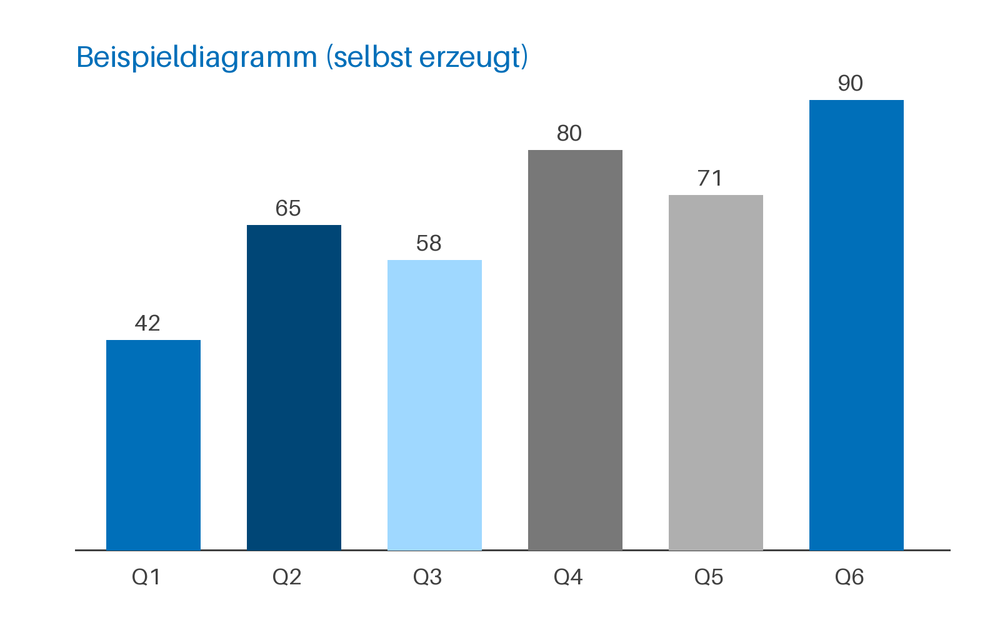
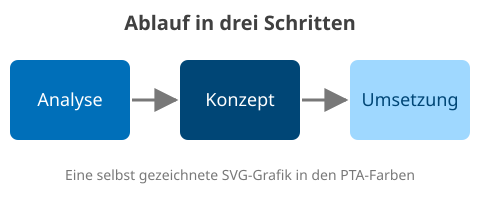

---
# Alle Schlüssel, die ein Word-Dokument kennt (Kommentarzeilen mit # sind erlaubt).
vorlage: hoch
titel: Funktionsübersicht PTA Documents
untertitel: "Word: alles, was der Generator kann"
autor: PTA Documents
ort: Hamburg
datum: 06.11.2026
firma: PTA IT-Beratung
sprache: de
inhaltsverzeichnis: ja
typografie: ja
syntaxhervorhebung: ja
pruefung: an
status.success: Erledigt
status.info: In Prüfung
status.warning: Als Nächstes
status.danger: Blockiert
status.neutral: Offen
---
# So liest man diese Übersicht

Jede Funktion steht unter einer eigenen Überschrift: ein kurzer Satz, darunter der
Markdown-Quelltext als Codeblock und danach das Ergebnis, so wie der Generator es setzt.

## Front Matter

Der Kopf der Datei zwischen zwei `---`-Zeilen wählt die Vorlage und füllt Deckblatt, Kopf- und
Fußzeile. Dieses Dokument beginnt so; das Ergebnis sind das Deckblatt, das Inhaltsverzeichnis
und die Fußzeile mit „Stand" und „Seite":

```markdown
---
# Alle Schlüssel, die ein Word-Dokument kennt (Kommentarzeilen mit # sind erlaubt).
vorlage: hoch
titel: Funktionsübersicht PTA Documents
untertitel: "Word: alles, was der Generator kann"
autor: PTA Documents
ort: Hamburg
datum: 06.11.2026
firma: PTA IT-Beratung
sprache: de
inhaltsverzeichnis: ja
typografie: ja
syntaxhervorhebung: ja
pruefung: an
status.success: Erledigt
status.info: In Prüfung
status.warning: Als Nächstes
status.danger: Blockiert
status.neutral: Offen
---
```

Der Titel kommt ausschließlich aus dem Front Matter. Jedes `#` ist ein Kapitel mit
„Überschrift 1", jedes `##` ein Abschnitt mit „Überschrift 2"; beide nummeriert Word.

# Text

## Tiefere Überschriften

Die dritte Ebene ist ebenfalls nummeriert, ab der vierten gibt es keine Nummer mehr:

```markdown
### Überschrift 3

Die dritte Ebene steht im Inhaltsverzeichnis.

#### Zwischenüberschrift ab Ebene 4

Ab `####` gilt die PTA-Formatvorlage "Zwischenüberschrift".

##### Auch Ebene 5 und 6

landen in der Zwischenüberschrift.
```

### Überschrift 3

Die dritte Ebene steht im Inhaltsverzeichnis.

#### Zwischenüberschrift ab Ebene 4

Ab `####` gilt die PTA-Formatvorlage "Zwischenüberschrift".

##### Auch Ebene 5 und 6

landen in der Zwischenüberschrift.

## Absätze und Umbrüche

Ein einfacher Zeilenumbruch wird zum Leerzeichen, ein Backslash am Zeilenende bricht um:

```markdown
Ein normaler Absatz in "Standard". Ein Zeilenumbruch
innerhalb des Absatzes wird zu einem Leerzeichen; ein harter Umbruch mit Backslash\
beginnt eine neue Zeile im selben Absatz.

**Ein Absatz, der nur aus Fettdruck besteht, wird "Standard fett".**
```

Ein normaler Absatz in "Standard". Ein Zeilenumbruch
innerhalb des Absatzes wird zu einem Leerzeichen; ein harter Umbruch mit Backslash\
beginnt eine neue Zeile im selben Absatz.

**Ein Absatz, der nur aus Fettdruck besteht, wird "Standard fett".**

## Zeichenformate

Die üblichen Auszeichnungen von Markdown:

```markdown
Text kann **fett**, *kursiv*, ***fett und kursiv***, ~~durchgestrichen~~ oder `Inline-Code`
sein.
```

Text kann **fett**, *kursiv*, ***fett und kursiv***, ~~durchgestrichen~~ oder `Inline-Code`
sein.

## Links

Absolute Links werden echte Hyperlinks, relative bleiben Text:

```markdown
Zur [PTA](https://www.pta.de), per [E-Mail](mailto:info@example.org) oder zu
[dieser Datei](README.md).
```

Zur [PTA](https://www.pta.de), per [E-Mail](mailto:info@example.org) oder zu
[dieser Datei](README.md).

## Fußnoten

Fußnoten werden echte Word-Fußnoten; die Definition darf irgendwo im Dokument stehen:

```markdown
Ein Satz mit Fußnote.[^erste] Mehrere sind möglich.[^zweite]

[^erste]: Fußnotentext in "Fußnotentext", mit **Formatierung** und [Link](https://example.org).
[^zweite]: Die zweite Fußnote.
```

Ein Satz mit Fußnote.[^erste] Mehrere sind möglich.[^zweite]

[^erste]: Fußnotentext in "Fußnotentext", mit **Formatierung** und [Link](https://example.org).
[^zweite]: Die zweite Fußnote.

## Bild im Text

Ein kleines Bild mitten im Satz bleibt im Absatz:

```markdown
Ein kleines Bild mitten im Text  bleibt im Absatz.
```

Ein kleines Bild mitten im Text  bleibt im Absatz.

## Typografie

Gerade Zeichen werden beim Erzeugen typografisch gesetzt; `typografie: nein` schaltet das ab
(siehe `varianten-hochformat-dokument.md`):

```markdown
Aus "Anführungszeichen" und 'halben' werden deutsche, aus " - " ein Gedankenstrich, z. B.
10 % oder S. 12 brechen nicht um, und drei Punkte... werden eine Ellipse. In `"Code"` bleibt
alles, wie es geschrieben ist.
```

Aus "Anführungszeichen" und 'halben' werden deutsche, aus " - " ein Gedankenstrich, z. B.
10 % oder S. 12 brechen nicht um, und drei Punkte... werden eine Ellipse. In `"Code"` bleibt
alles, wie es geschrieben ist.

# Listen

## Aufzählungen

Drei Ebenen mit den PTA-Aufzählungszeichen, ein zweiter Absatz im selben Punkt ist eingerückt:

```markdown
- Aufzählung, erste Ebene (blaues Quadrat)
  - zweite Ebene (Strich)
    - dritte Ebene
- noch ein Punkt der ersten Ebene

  mit einem zweiten Absatz im selben Punkt
```

- Aufzählung, erste Ebene (blaues Quadrat)
  - zweite Ebene (Strich)
    - dritte Ebene
- noch ein Punkt der ersten Ebene

  mit einem zweiten Absatz im selben Punkt

## Nummerierte Listen

Ein Absatz unterbricht die Liste, die nächste beginnt wieder bei 1:

```markdown
1. Nummerierte Liste
2. zweiter Schritt
   - eine Aufzählung darin
3. dritter Schritt

Ein Absatz dazwischen.

1. neu bei eins
2. und weiter
```

1. Nummerierte Liste
2. zweiter Schritt
   - eine Aufzählung darin
3. dritter Schritt

Ein Absatz dazwischen.

1. neu bei eins
2. und weiter

## Aufgabenlisten

Kästchen zum Abhaken:

```markdown
- [x] erledigt
- [ ] offen
```

- [x] erledigt
- [ ] offen

## Definitionslisten

Begriff und Erklärung:

```markdown
Formatvorlage
: Eine benannte Formatierung der PTA-Vorlage.

Front Matter
: Der Kopf des Dokuments zwischen zwei `---`-Zeilen.
```

Formatvorlage
: Eine benannte Formatierung der PTA-Vorlage.

Front Matter
: Der Kopf des Dokuments zwischen zwei `---`-Zeilen.

# Tabellen

## Tabelle mit Titel und Beschriftung

Ein fetter Absatz direkt davor ist der Titel, „Tabelle: …" direkt danach die Beschriftung:

```markdown
**Tabellentitel: ein fetter Absatz direkt vor der Tabelle**

| Spalte links | Mitte | Zahlen rechts |
| :----------- | :---: | ------------: |
| Text mit **fett** | zentriert | 1.234,50 € |
| Zeile zwei | – | 42 % |
| eine längere Zelle, deren Text umbricht, damit die Spaltenbreiten sichtbar werden | x | 7 |

Tabelle: Beschriftung unter der Tabelle
```

**Tabellentitel: ein fetter Absatz direkt vor der Tabelle**

| Spalte links | Mitte | Zahlen rechts |
| :----------- | :---: | ------------: |
| Text mit **fett** | zentriert | 1.234,50 € |
| Zeile zwei | – | 42 % |
| eine längere Zelle, deren Text umbricht, damit die Spaltenbreiten sichtbar werden | x | 7 |

Tabelle: Beschriftung unter der Tabelle

## Tabelle ohne Titel

Ohne fetten Absatz und ohne „Tabelle:" bleibt es bei der Tabelle:

```markdown
| A | B |
| --- | --- |
| 1 | 2 |
```

| A | B |
| --- | --- |
| 1 | 2 |

## Status-Labels

Eine Zelle, die nur aus Code besteht, dessen Text im Front Matter unter `status.<kategorie>`
steht, erscheint in der Farbe dieser Kategorie:

```markdown
| Teil | Status |
| ---- | ------ |
| Erfassung | `Erledigt` |
| Prüfung | `In Prüfung` |
| Engine | `Als Nächstes` |
| Schnittstelle | `Blockiert` |
| Archiv | `Offen` |
```

| Teil | Status |
| ---- | ------ |
| Erfassung | `Erledigt` |
| Prüfung | `In Prüfung` |
| Engine | `Als Nächstes` |
| Schnittstelle | `Blockiert` |
| Archiv | `Offen` |

## Markierte Zeile

Ist die erste Zelle ganz `==markiert==`, wird die ganze Zeile hinterlegt:

```markdown
| Status | Weiter durch |
| ------ | ------------ |
| Angelegt | System |
| ==Wartet auf Freigabe== | Mensch |
```

| Status | Weiter durch |
| ------ | ------------ |
| Angelegt | System |
| ==Wartet auf Freigabe== | Mensch |

# Bilder

## Abbildung mit Titel

Ein Bild allein im Absatz bekommt eine Abbildungsbeschriftung aus seinem Titel:

```markdown

```


## Abbildung mit Alt-Text

Ohne Titel dient der Alt-Text als Beschriftung; breite Bilder werden auf Satzspiegelbreite
verkleinert:

```markdown

```


## Bildreihe

Mehrere Bilder in einem Absatz stehen nebeneinander, jedes mit eigener Beschriftung:

```markdown
  
```

  

## SVG-Grafik

Eine SVG-Grafik steht in ihrer natürlichen Größe da und bleibt in Word in jeder Vergrößerung
scharf (ältere Word-Versionen zeigen ein Bild in doppelter Auflösung):

```markdown

```


# Code, Zitat und Trennlinie

## Codeblock

Ein Codeblock mit Sprache wird farbig hervorgehoben:

````markdown
```python
from pta_documents.generation.docx.generator import DocxGenerator

# Schlüsselwörter blau, Zeichenketten dunkelblau, Kommentare grau
with open("bericht.docx", "wb") as output:
    DocxGenerator().generate(document, output)
```
````

```python
from pta_documents.generation.docx.generator import DocxGenerator

# Schlüsselwörter blau, Zeichenketten dunkelblau, Kommentare grau
with open("bericht.docx", "wb") as output:
    DocxGenerator().generate(document, output)
```

## Zitat

Ein Zitat wird eingerückt:

```markdown
> Ein Zitat wird in die Formatvorlage "Zitat" gesetzt
> und eingerückt.
```

> Ein Zitat wird in die Formatvorlage "Zitat" gesetzt
> und eingerückt.

## Trennlinie

Drei Striche zwischen Leerzeilen ziehen eine Linie:

```markdown
Vor der Linie.

---

Nach der Linie.
```

Vor der Linie.

---

Nach der Linie.

# Folien-Syntax in Word

## Karten und Zeilen

Word zeigt den Inhalt der Container nacheinander; Überschriften und Kennzahlen darin werden
„Standard fett":

```markdown
::: cards
### Die Konfiguration ist zu kompliziert
**26 Tabellen**

für 12 Arten von Regeln.
:::

::: rows
- **Große Fahrpläne** – werden seitenweise geschrieben
- **Neue Preislogik** – ist eine Formel, keine Tabelle
:::
```

::: cards
### Die Konfiguration ist zu kompliziert
**26 Tabellen**

für 12 Arten von Regeln.
:::

::: rows
- **Große Fahrpläne** – werden seitenweise geschrieben
- **Neue Preislogik** – ist eine Formel, keine Tabelle
:::

## Fläche und Aussage

Fläche (auch dunkel) und Aussage; der erste Absatz einer Aussage wird „Standard fett":

```markdown
::: panel
Eine helle Fläche hebt einen Gedanken hervor.
:::

::: panel dark
Eine dunkle Fläche ebenso.
:::

::: statement
Ein Broker garantiert die Zustellung, nicht die Verarbeitung.

Darunter die Begründung.
:::
```

::: panel
Eine helle Fläche hebt einen Gedanken hervor.
:::

::: panel dark
Eine dunkle Fläche ebenso.
:::

::: statement
Ein Broker garantiert die Zustellung, nicht die Verarbeitung.

Darunter die Begründung.
:::

## Spalten

Spalten werden mit `---` getrennt, die Breiten als Verhältnis angegeben; in Word stehen sie
untereinander:

```markdown
::: columns 1:2
**Heute**

26 Tabellen für 12 Arten von Regeln

---

**Morgen**

Ein Dokument je Revision
:::
```

::: columns 1:2
**Heute**

26 Tabellen für 12 Arten von Regeln

---

**Morgen**

Ein Dokument je Revision
:::

## Fazit und Kommentar

Beide werden „Hinweis" mit fettem Anfang:

```markdown
Ziel des Schattenlaufs sind gleiche Ergebnisse.

::: comment
Ziel: 100 %
:::

::: conclusion
Erst nach vier Wochen gleicher Ergebnisse wird umgestellt.
:::
```

Ziel des Schattenlaufs sind gleiche Ergebnisse.

::: comment
Ziel: 100 %
:::

::: conclusion
Erst nach vier Wochen gleicher Ergebnisse wird umgestellt.
:::

## Hinweise

Die fünf Arten von Hinweisen; die drei letzten sind gelb statt blau:

```markdown
> [!NOTE]
> Ein Hinweis.

> [!TIP]
> Ein Tipp.

> [!IMPORTANT]
> Etwas Wichtiges.

> [!WARNING]
> Eine Warnung.

> [!CAUTION]
> Ein Grund zur Vorsicht.
```

> [!NOTE]
> Ein Hinweis.

> [!TIP]
> Ein Tipp.

> [!IMPORTANT]
> Etwas Wichtiges.

> [!WARNING]
> Eine Warnung.

> [!CAUTION]
> Ein Grund zur Vorsicht.

## Markierung und farbige Wörter

Markierte Wörter stehen auf PTA-Gelb, farbige Wörter in der Farbe ihrer Kategorie:

```markdown
Zeilen in der ==Hervorhebungsfarbe== brauchen einen Menschen. Stand heute:
[im Plan]{.success}, [unter Beobachtung]{.warning}, [gestoppt]{.danger},
[zur Kenntnis]{.info} und [ohne Bewertung]{.neutral}.
```

Zeilen in der ==Hervorhebungsfarbe== brauchen einen Menschen. Stand heute:
[im Plan]{.success}, [unter Beobachtung]{.warning}, [gestoppt]{.danger},
[zur Kenntnis]{.info} und [ohne Bewertung]{.neutral}.
