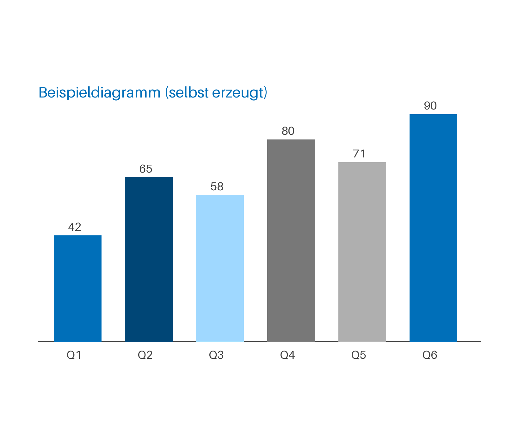
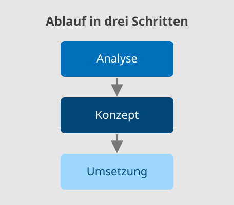

Text vor der ersten Überschrift wird ignoriert.

# Funktionsübersicht PTA Documents

::: notes
Begrüßen und sagen, dass jede Folie eine Funktion des Generators zeigt. Den Markdown-Quelltext
jeder Folie zeigt ihre Notizenseite.
:::

# Text

## Textebenen der PTA-Vorlage

Ein Absatz ist die Ebene „Einleitungstext".

- Aufzählung, erste Ebene
  - zweite Ebene
    - dritte Ebene

### Eine Subheadline mit ###

Text kann **fett** (in Segoe UI), *kursiv*, ~~durchgestrichen~~, `Code` und ein
[Link](https://www.pta.de) sein.

::: notes
Die Ebenen kommen aus dem Folienmaster der PTA-Vorlage. Sprechernotizen schreibt man in einen
Block `::: notes` unter die Überschrift der Folie:

- Absätze und Listen bleiben erhalten,
- ebenso **fett**, *kursiv*, `Code` und [Links](https://www.pta.de).
:::

:::: notes
```markdown
## Textebenen der PTA-Vorlage

Ein Absatz ist die Ebene „Einleitungstext".

- Aufzählung, erste Ebene
  - zweite Ebene
    - dritte Ebene

### Eine Subheadline mit ###

Text kann **fett** (in Segoe UI), *kursiv*, ~~durchgestrichen~~, `Code` und ein
[Link](https://www.pta.de) sein.

::: notes
Die Ebenen kommen aus dem Folienmaster der PTA-Vorlage. Sprechernotizen schreibt man in einen
Block `::: notes` unter die Überschrift der Folie:

- Absätze und Listen bleiben erhalten,
- ebenso **fett**, *kursiv*, `Code` und [Links](https://www.pta.de).
:::
```
::::

## Nummerierte Listen

3. Listen dürfen bei einer anderen Zahl beginnen
4. und zählen weiter
   1. auch verschachtelt

> Zitate erscheinen kursiv.

:::: notes
```markdown
## Nummerierte Listen

3. Listen dürfen bei einer anderen Zahl beginnen
4. und zählen weiter
   1. auch verschachtelt

> Zitate erscheinen kursiv.
```
::::

## Viel Text wird verkleinert

- Punkt 1: Inhalte, die nicht in voller Größe auf eine Folie passen, werden verkleinert.
- Punkt 2: Die Untergrenze ist 12 pt.
- Punkt 3: Passt es auch dann nicht, geht es auf einer weiteren Folie mit „(Forts.)" weiter.
- Punkt 4: Das meldet `./run.sh generate` als Hinweis `slide-split`.
- Punkt 5: Geteilt wird zwischen Punkten, nie mitten in einem Punkt.
- Punkt 6: Verschachtelte Punkte bleiben bei ihrem Elternpunkt.
  - zum Beispiel dieser
- Punkt 7: Besser sind kurze Folien.
- Punkt 8: Diese Folie zeigt das Verkleinern absichtlich.
- Punkt 9: Noch ein Punkt.
- Punkt 10: Noch ein Punkt.
- Punkt 11: Noch ein Punkt.
- Punkt 12: Noch ein Punkt.

:::: notes
```markdown
## Viel Text wird verkleinert

- Punkt 1: Inhalte, die nicht in voller Größe auf eine Folie passen, werden verkleinert.
- Punkt 2: Die Untergrenze ist 12 pt.
- Punkt 3: Passt es auch dann nicht, geht es auf einer weiteren Folie mit „(Forts.)" weiter.
- Punkt 4: Das meldet `./run.sh generate` als Hinweis `slide-split`.
- Punkt 5: Geteilt wird zwischen Punkten, nie mitten in einem Punkt.
- Punkt 6: Verschachtelte Punkte bleiben bei ihrem Elternpunkt.
  - zum Beispiel dieser
- Punkt 7: Besser sind kurze Folien.
- Punkt 8: Diese Folie zeigt das Verkleinern absichtlich.
- Punkt 9: Noch ein Punkt.
- Punkt 10: Noch ein Punkt.
- Punkt 11: Noch ein Punkt.
- Punkt 12: Noch ein Punkt.
```
::::

# Tabellen und Code

## Tabelle im PTA-Stil

Text vor der Tabelle steht oben.

**Umsatz nach Region**

| Region | Umsatz | Veränderung |
| :----- | -----: | :---------: |
| Nord | 1.200 | +4 % |
| Süd | 950 | -2 % |
| West | 1.480 | +7 % |

Text nach der Tabelle steht unten, zum Beispiel eine Quelle.

:::: notes
```markdown
## Tabelle im PTA-Stil

Text vor der Tabelle steht oben.

**Umsatz nach Region**

| Region | Umsatz | Veränderung |
| :----- | -----: | :---------: |
| Nord | 1.200 | +4 % |
| Süd | 950 | -2 % |
| West | 1.480 | +7 % |

Text nach der Tabelle steht unten, zum Beispiel eine Quelle.
```
::::

## Längere Tabelle

| Nr. | Eintrag | Wert |
| --- | ------- | ---: |
| 1 | Zeile | 10 |
| 2 | Zeile | 20 |
| 3 | Zeile | 30 |
| 4 | Zeile | 40 |
| 5 | Zeile | 50 |
| 6 | Zeile | 60 |
| 7 | Zeile | 70 |
| 8 | Zeile | 80 |
| 9 | Zeile | 90 |

Längere Tabellen werden mit wiederholter Kopfzeile geteilt (Hinweis `slide-split`).

:::: notes
```markdown
## Längere Tabelle

| Nr. | Eintrag | Wert |
| --- | ------- | ---: |
| 1 | Zeile | 10 |
| 2 | Zeile | 20 |
| 3 | Zeile | 30 |
| 4 | Zeile | 40 |
| 5 | Zeile | 50 |
| 6 | Zeile | 60 |
| 7 | Zeile | 70 |
| 8 | Zeile | 80 |
| 9 | Zeile | 90 |

Längere Tabellen werden mit wiederholter Kopfzeile geteilt (Hinweis `slide-split`).
```
::::

## Code

```python
from pta_documents.generation.pptx.generator import PptxGenerator

# Farbig im PTA-Schema, wenn die Sprache angegeben ist
with open("folien.pptx", "wb") as output:
    PptxGenerator().generate(document, output)
```

:::: notes
````markdown
## Code

```python
from pta_documents.generation.pptx.generator import PptxGenerator

# Farbig im PTA-Schema, wenn die Sprache angegeben ist
with open("folien.pptx", "wb") as output:
    PptxGenerator().generate(document, output)
```
````
::::

# Bilder

## Bild mit Text

Ein Bild und Text ergeben das Layout „Titel, Text und Bild 01"; das Bild füllt seinen Rahmen
und wird beschnitten. Dieses Bild hat schon die Proportionen des Rahmens.



:::: notes
```markdown
## Bild mit Text

Ein Bild und Text ergeben das Layout „Titel, Text und Bild 01"; das Bild füllt seinen Rahmen
und wird beschnitten. Dieses Bild hat schon die Proportionen des Rahmens.


```
::::

## Bild allein


:::: notes
```markdown
## Bild allein


```
::::

## SVG-Grafik

Eine SVG-Grafik füllt ihren Rahmen wie jedes Bild und bleibt in PowerPoint in jeder Größe
scharf; ältere Versionen zeigen ein Bild in doppelter Auflösung.



:::: notes
```markdown
## SVG-Grafik

Eine SVG-Grafik füllt ihren Rahmen wie jedes Bild und bleibt in PowerPoint in jeder Größe
scharf; ältere Versionen zeigen ein Bild in doppelter Auflösung.


```
::::

## Bilder nebeneinander

  

Bis zu vier Bilder stehen nebeneinander; Text danach steht darunter.

:::: notes
```markdown
## Bilder nebeneinander

  

Bis zu vier Bilder stehen nebeneinander; Text danach steht darunter.
```
::::

## QR-Code

Ein Link mit `qr:` davor wird ein QR-Code in PTA-Blau. Er wird in seinen Rahmen eingepasst,
nie beschnitten.


:::: notes
```markdown
## QR-Code

Ein Link mit `qr:` davor wird ein QR-Code in PTA-Blau. Er wird in seinen Rahmen eingepasst,
nie beschnitten.


```
::::

# Layouts

## Zwei Spalten {layout="Titel und Text (zweispaltig)"}

Linke Spalte

- mit Aufzählung

---

Rechte Spalte

- nach der Trennlinie `---`

:::: notes
```markdown
## Zwei Spalten {layout="Titel und Text (zweispaltig)"}

Linke Spalte

- mit Aufzählung

---

Rechte Spalte

- nach der Trennlinie `---`
```
::::

## Jedes PTA-Layout über seinen Namen {layout="Titel, Text und Bild 03"}

Mit `{layout="…"}` wird jedes der 35 PTA-Layouts gewählt; Text und Bilder füllen dessen
Platzhalter der Reihe nach.


:::: notes
```markdown
## Jedes PTA-Layout über seinen Namen {layout="Titel, Text und Bild 03"}

Mit `{layout="…"}` wird jedes der 35 PTA-Layouts gewählt; Text und Bilder füllen dessen
Platzhalter der Reihe nach.


```
::::

# Flow-Folien

## Karten {kicker="Container"}

::: cards
### Die Konfiguration ist zu kompliziert
**26 Tabellen**

für 12 Arten von Regeln

### Große Fahrpläne sind zu langsam
**3,2 GB**

Speicher je Fahrplan bei 5.000 Halten
:::

:::: notes
```markdown
## Karten {kicker="Container"}

::: cards
### Die Konfiguration ist zu kompliziert
**26 Tabellen**

für 12 Arten von Regeln

### Große Fahrpläne sind zu langsam
**3,2 GB**

Speicher je Fahrplan bei 5.000 Halten
:::
```
::::

## Zeilen {kicker="Container"}

::: rows
- **Wirklich große Fahrpläne** – Dokumente werden seitenweise geschrieben
- **Mehr Flexibilität** – neue Preislogik ist eine Formel, keine Tabelle
- **Reproduzierbare Ergebnisse** – jede Berechnung hält ihre Eingaben fest
:::

:::: notes
```markdown
## Zeilen {kicker="Container"}

::: rows
- **Wirklich große Fahrpläne** – Dokumente werden seitenweise geschrieben
- **Mehr Flexibilität** – neue Preislogik ist eine Formel, keine Tabelle
- **Reproduzierbare Ergebnisse** – jede Berechnung hält ihre Eingaben fest
:::
```
::::

## Flächen {kicker="Container"}

:::: panel
**Unterwegs behoben**

::: cards
- **Sperren** – der Join zählt wieder ohne Sperre
- **Duplikate** – der Export-Wächter filtert jede Zeile
:::
::::

::: panel dark
### Jedes Ergebnis hat ein Manifest
Buchungsrevision, Regelversion und Parameterrevision.
:::

::::: notes
```markdown
## Flächen {kicker="Container"}

:::: panel
**Unterwegs behoben**

::: cards
- **Sperren** – der Join zählt wieder ohne Sperre
- **Duplikate** – der Export-Wächter filtert jede Zeile
:::
::::

::: panel dark
### Jedes Ergebnis hat ein Manifest
Buchungsrevision, Regelversion und Parameterrevision.
:::
```
:::::

## Aussage auf dunklem Grund {.dark kicker="Aussage"}

::: statement
Ein Broker garantiert die Zustellung mindestens einmal – nicht die Verarbeitung höchstens einmal.

Der Wettlauf im alten System geschah mit einem Broker.
:::

:::: notes
```markdown
## Aussage auf dunklem Grund {.dark kicker="Aussage"}

::: statement
Ein Broker garantiert die Zustellung mindestens einmal – nicht die Verarbeitung höchstens einmal.

Der Wettlauf im alten System geschah mit einem Broker.
:::
```
::::

## Vorher und nachher

::: columns
**Heute**

- 26 Tabellen für 12 Arten von Regeln
- Sperren im Join

---

**Mit Hafen**

- Ein Dokument je Revision
- Keine Datenbank, kein Message Broker
:::

:::: notes
```markdown
## Vorher und nachher

::: columns
**Heute**

- 26 Tabellen für 12 Arten von Regeln
- Sperren im Join

---

**Mit Hafen**

- Ein Dokument je Revision
- Keine Datenbank, kein Message Broker
:::
```
::::

## Spalten, Kommentar und Fazit {kicker="PTA"}

:::: columns 1:2
**Vier Wochen** lang rechnen altes System und Hafen dieselben Buchungen.

---

| Woche | Gleiche Ergebnisse |
| ----- | ------------------ |
| 1 | 91 % |
| 2 | 97 % |
| 3 | 99 % |

::: comment
Ziel: 100 %
:::
::::

::: conclusion
Erst wenn der Schattenlauf vier Wochen lang gleiche Ergebnisse liefert, wird umgestellt.
:::

::::: notes
```markdown
## Spalten, Kommentar und Fazit {kicker="PTA"}

:::: columns 1:2
**Vier Wochen** lang rechnen altes System und Hafen dieselben Buchungen.

---

| Woche | Gleiche Ergebnisse |
| ----- | ------------------ |
| 1 | 91 % |
| 2 | 97 % |
| 3 | 99 % |

::: comment
Ziel: 100 %
:::
::::

::: conclusion
Erst wenn der Schattenlauf vier Wochen lang gleiche Ergebnisse liefert, wird umgestellt.
:::
```
:::::

## Hinweise {kicker="Alerts"}

> [!NOTE]
> **Hinweis und Tipp** stehen auf einer Fläche mit blauem Balken.

> [!TIP]
> Ein Tipp sieht aus wie ein Hinweis.

:::: notes
```markdown
## Hinweise {kicker="Alerts"}

> [!NOTE]
> **Hinweis und Tipp** stehen auf einer Fläche mit blauem Balken.

> [!TIP]
> Ein Tipp sieht aus wie ein Hinweis.
```
::::

## Wichtige Hinweise {kicker="Alerts"}

> [!IMPORTANT]
> **Wichtig, Warnung und Vorsicht** haben einen gelben Balken.

> [!WARNING]
> Eine Warnung.

> [!CAUTION]
> Ein Grund zur Vorsicht.

:::: notes
```markdown
## Wichtige Hinweise {kicker="Alerts"}

> [!IMPORTANT]
> **Wichtig, Warnung und Vorsicht** haben einen gelben Balken.

> [!WARNING]
> Eine Warnung.

> [!CAUTION]
> Ein Grund zur Vorsicht.
```
::::

## Markierung und farbige Wörter {kicker="Text"}

| Status | Weiter durch |
| ------ | ------------ |
| Angelegt | System |
| ==Wartet auf Freigabe== | Mensch |

Zeilen in der ==Hervorhebungsfarbe== brauchen einen Menschen. Stand: [im Plan]{.success},
[unter Beobachtung]{.warning}, [gestoppt]{.danger}, [zur Kenntnis]{.info},
[ohne Bewertung]{.neutral}.

:::: notes
```markdown
## Markierung und farbige Wörter {kicker="Text"}

| Status | Weiter durch |
| ------ | ------------ |
| Angelegt | System |
| ==Wartet auf Freigabe== | Mensch |

Zeilen in der ==Hervorhebungsfarbe== brauchen einen Menschen. Stand: [im Plan]{.success},
[unter Beobachtung]{.warning}, [gestoppt]{.danger}, [zur Kenntnis]{.info},
[ohne Bewertung]{.neutral}.
```
::::

## Status-Labels {kicker="Tabellen"}

| Teil | Status |
| ---- | ------ |
| Erfassung | `Erledigt` |
| Prüfung | `In Prüfung` |
| Engine | `Als Nächstes` |
| Schnittstelle | `Blockiert` |
| Archiv | `Offen` |

:::: notes
```markdown
## Status-Labels {kicker="Tabellen"}

| Teil | Status |
| ---- | ------ |
| Erfassung | `Erledigt` |
| Prüfung | `In Prüfung` |
| Engine | `Als Nächstes` |
| Schnittstelle | `Blockiert` |
| Archiv | `Offen` |
```

Die Texte stehen im Front Matter: `status.success: Erledigt` usw.
::::

# Zeitstrahl und Projektplan

## Zeitstrahl {kicker="Visuelle Bausteine"}

::: timeline
- 2026-01: Kick-off {.done}
- 2026-Q2: Analyse abgeschlossen
- 15.09.2026: Go-live
- 2027: Betrieb
:::

:::: notes
```markdown
## Zeitstrahl {kicker="Visuelle Bausteine"}

::: timeline
- 2026-01: Kick-off {.done}
- 2026-Q2: Analyse abgeschlossen
- 15.09.2026: Go-live
- 2027: Betrieb
:::
```

Termine: Jahr, Monat, Quartal, Tag oder `heute`. Erledigtes (`{.done}`) und alles vor dem
`datum` ist grau.
::::

## Projektplan {kicker="Visuelle Bausteine"}

::: gantt raster=monat
| Vorgang   | Start      | Ende       | Wer   |
| --------- | ---------- | ---------- | ----- |
| Analyse   | 2026-10-05 | 2026-11-27 | PTA   |
| Umsetzung | 2026-11-30 | 2027-03-31 | PTA   |
| Abnahme   | 2027-04-01 | 2027-04-16 | Kunde |
| Go-live   | 2027-04-19 | 2027-04-19 | PTA   |
:::

:::: notes
```markdown
## Projektplan {kicker="Visuelle Bausteine"}

::: gantt raster=monat
| Vorgang   | Start      | Ende       | Wer   |
| --------- | ---------- | ---------- | ----- |
| Analyse   | 2026-10-05 | 2026-11-27 | PTA   |
| Umsetzung | 2026-11-30 | 2027-03-31 | PTA   |
| Abnahme   | 2027-04-01 | 2027-04-16 | Kunde |
| Go-live   | 2027-04-19 | 2027-04-19 | PTA   |
:::
```

Ein Meilenstein hat Start = Ende; wer nicht wie die erste Zeile heißt, ist hellblau.
::::

# Diagramme

## Balkendiagramm

```chart
type: bar
title: Aufträge je Quartal
unit: Mio. EUR
source: Quelle: Vertrieb, Beispielzahlen
---
Quartal, Plan, Ist
Q1, 12.5, 13.2
Q2, 11.8, 12.1
Q3, 12.5, 14
Q4, 13, 13.6
```

:::: notes
````markdown
## Balkendiagramm

```chart
type: bar
title: Aufträge je Quartal
unit: Mio. EUR
source: Quelle: Vertrieb, Beispielzahlen
---
Quartal, Plan, Ist
Q1, 12.5, 13.2
Q2, 11.8, 12.1
Q3, 12.5, 14
Q4, 13, 13.6
```
````
::::

## Linien mit Text davor

Ein `chart`-Block wird ein echtes Diagramm; „Daten bearbeiten“ öffnet seine Tabelle.

```chart
type: line
title: Antwortzeit
unit: ms
---
Monat; Median; 95. Perzentil
Jan; 120,5; 310
Feb; 118; 295,5
Mär; 101; 260
Apr; 96,5;
Mai; 92; 230
```

:::: notes
````markdown
## Linien mit Text davor

Ein `chart`-Block wird ein echtes Diagramm; „Daten bearbeiten“ öffnet seine Tabelle.

```chart
type: line
title: Antwortzeit
unit: ms
---
Monat; Median; 95. Perzentil
Jan; 120,5; 310
Feb; 118; 295,5
Mär; 101; 260
Apr; 96,5;
Mai; 92; 230
```
````
::::

## Gestapelte Flächen mit Text danach

```chart
type: area
stacked: true
title: Fahrten je Tag
unit: Tsd.
---
Tag, Bus, Bahn
Mo, 41, 55
Di, 43, 57
Mi, 42, 58
Do, 44, 60
Fr, 47, 63
```

Mit `stacked: true` liegen Flächen oder Balken übereinander.

:::: notes
````markdown
## Gestapelte Flächen mit Text danach

```chart
type: area
stacked: true
title: Fahrten je Tag
unit: Tsd.
---
Tag, Bus, Bahn
Mo, 41, 55
Di, 43, 57
Mi, 42, 58
Do, 44, 60
Fr, 47, 63
```

Mit `stacked: true` liegen Flächen oder Balken übereinander.
````
::::

## Zwei Diagramme

::: columns
```chart
title: Umsatz
unit: Mio. EUR
---
Jahr, Umsatz
2024, 41
2025, 45
```

---

```chart
type: line
title: Marge
unit: %
---
Jahr, Marge
2024, 8.5
2025, 9.1
```
:::

:::: notes
````markdown
## Zwei Diagramme

::: columns
```chart
title: Umsatz
unit: Mio. EUR
---
Jahr, Umsatz
2024, 41
2025, 45
```

---

```chart
type: line
title: Marge
unit: %
---
Jahr, Marge
2024, 8.5
2025, 9.1
```
:::
````
::::

# Finanzdiagramme

## Finanzdiagramm: Entwicklung

Monat für Monat oben, kumuliert unten; gestrichelt ist die Prognose.

```financial-chart
{
  "type": "development",
  "title": "Aufträge",
  "period": "April 2026",
  "lastActual": 3,
  "referenceRate": 0.05,
  "changeAtPeriod": 0.048,
  "changeAtYearEnd": 0.035,
  "estimates": [
    {"month": 5, "label": "Schätzung", "value": 103}
  ],
  "months": [
    {"label": "Jan", "previous": 14.2, "current": 15.0, "projection": 14.8, "previousCumulative": 14.2, "currentCumulative": 15.0, "projectionCumulative": 14.8, "reference": 14.9, "referenceCumulative": 14.9},
    {"label": "Feb", "previous": 15.1, "current": 15.9, "projection": 15.6, "previousCumulative": 29.3, "currentCumulative": 30.9, "projectionCumulative": 30.4, "reference": 15.9, "referenceCumulative": 30.8},
    {"label": "Mär", "previous": 17.8, "current": 18.1, "projection": 18.0, "previousCumulative": 47.1, "currentCumulative": 49.0, "projectionCumulative": 48.4, "reference": 18.7, "referenceCumulative": 49.5},
    {"label": "Apr", "previous": 16.4, "current": 17.9, "projection": 17.5, "previousCumulative": 63.5, "currentCumulative": 66.9, "projectionCumulative": 65.9, "reference": 17.2, "referenceCumulative": 66.7},
    {"label": "Mai", "previous": 17.0, "current": null, "projection": 18.6, "previousCumulative": 80.5, "currentCumulative": null, "projectionCumulative": 84.5, "reference": 17.9, "referenceCumulative": 84.5},
    {"label": "Jun", "previous": 18.3, "current": null, "projection": 19.1, "previousCumulative": 98.8, "currentCumulative": null, "projectionCumulative": 103.6, "reference": 19.2, "referenceCumulative": 103.7}
  ],
  "options": {"unit": "Mio. EUR"}
}
```

:::: notes
````markdown
## Finanzdiagramm: Entwicklung

Monat für Monat oben, kumuliert unten; gestrichelt ist die Prognose.

```financial-chart
{
  "type": "development",
  "title": "Aufträge",
  "period": "April 2026",
  "lastActual": 3,
  "referenceRate": 0.05,
  "changeAtPeriod": 0.048,
  "changeAtYearEnd": 0.035,
  "estimates": [
    {"month": 5, "label": "Schätzung", "value": 103}
  ],
  "months": [
    {"label": "Jan", "previous": 14.2, "current": 15.0, "projection": 14.8, "previousCumulative": 14.2, "currentCumulative": 15.0, "projectionCumulative": 14.8, "reference": 14.9, "referenceCumulative": 14.9},
    {"label": "Feb", "previous": 15.1, "current": 15.9, "projection": 15.6, "previousCumulative": 29.3, "currentCumulative": 30.9, "projectionCumulative": 30.4, "reference": 15.9, "referenceCumulative": 30.8},
    {"label": "Mär", "previous": 17.8, "current": 18.1, "projection": 18.0, "previousCumulative": 47.1, "currentCumulative": 49.0, "projectionCumulative": 48.4, "reference": 18.7, "referenceCumulative": 49.5},
    {"label": "Apr", "previous": 16.4, "current": 17.9, "projection": 17.5, "previousCumulative": 63.5, "currentCumulative": 66.9, "projectionCumulative": 65.9, "reference": 17.2, "referenceCumulative": 66.7},
    {"label": "Mai", "previous": 17.0, "current": null, "projection": 18.6, "previousCumulative": 80.5, "currentCumulative": null, "projectionCumulative": 84.5, "reference": 17.9, "referenceCumulative": 84.5},
    {"label": "Jun", "previous": 18.3, "current": null, "projection": 19.1, "previousCumulative": 98.8, "currentCumulative": null, "projectionCumulative": 103.6, "reference": 19.2, "referenceCumulative": 103.7}
  ],
  "options": {"unit": "Mio. EUR"}
}
```
````
::::

## Finanzdiagramm: Wachstum je Zeile

```financial-chart
{
  "type": "growth-by-row",
  "title": "Wachstum je Region",
  "period": "April 2026",
  "rows": [
    {"label": "Nord", "change": 0.081, "reference": 0.05},
    {"label": "Süd", "change": 0.032, "reference": 0.05, "emphasised": true},
    {"label": "Ost", "change": -0.021, "reference": 0.04},
    {"label": "West", "change": 0.124, "reference": 0.06}
  ],
  "overall": {"change": 0.052, "reference": 0.05},
  "options": {"width": 600}
}
```

:::: notes
````markdown
## Finanzdiagramm: Wachstum je Zeile

```financial-chart
{
  "type": "growth-by-row",
  "title": "Wachstum je Region",
  "period": "April 2026",
  "rows": [
    {"label": "Nord", "change": 0.081, "reference": 0.05},
    {"label": "Süd", "change": 0.032, "reference": 0.05, "emphasised": true},
    {"label": "Ost", "change": -0.021, "reference": 0.04},
    {"label": "West", "change": 0.124, "reference": 0.06}
  ],
  "overall": {"change": 0.052, "reference": 0.05},
  "options": {"width": 600}
}
```
````
::::

## Finanzdiagramm: Ist gegen Plan

```financial-chart
{
  "type": "actual-vs-reference",
  "title": "Ist gegen Plan",
  "period": "April 2026",
  "display": "growth",
  "rows": [
    {"label": "Alle Regionen", "aggregate": true, "measures": [{"series": "auftraege", "label": "Aufträge (Monat)", "yearToDate": false, "current": 18.4, "change": 0.031, "reference": 0.05, "referenceValue": 18.0}, {"series": "auftraege", "label": "Aufträge (lfd. J.)", "yearToDate": true, "current": 66.9, "change": 0.052, "reference": 0.05, "referenceValue": 66.0}, {"series": "umsatz", "label": "Umsatz (Monat)", "yearToDate": false, "current": 16.2, "change": 0.044, "reference": 0.06, "referenceValue": 16.0}, {"series": "umsatz", "label": "Umsatz (lfd. J.)", "yearToDate": true, "current": 60.3, "change": 0.061, "reference": 0.06, "referenceValue": 61.0}]},
    {"label": "Nord", "aggregate": false, "measures": [{"series": "auftraege", "label": "Aufträge (Monat)", "yearToDate": false, "current": 18.4, "change": 0.12, "reference": 0.05, "referenceValue": 18.0}, {"series": "auftraege", "label": "Aufträge (lfd. J.)", "yearToDate": true, "current": 66.9, "change": 0.081, "reference": 0.05, "referenceValue": 66.0}, {"series": "umsatz", "label": "Umsatz (Monat)", "yearToDate": false, "current": 16.2, "change": 0.09, "reference": 0.06, "referenceValue": 16.0}, {"series": "umsatz", "label": "Umsatz (lfd. J.)", "yearToDate": true, "current": 60.3, "change": 0.07, "reference": 0.06, "referenceValue": 61.0}]},
    {"label": "Süd", "aggregate": false, "measures": [{"series": "auftraege", "label": "Aufträge (Monat)", "yearToDate": false, "current": 18.4, "change": -0.04, "reference": 0.05, "referenceValue": 18.0}, {"series": "auftraege", "label": "Aufträge (lfd. J.)", "yearToDate": true, "current": 66.9, "change": 0.032, "reference": 0.05, "referenceValue": 66.0}, {"series": "umsatz", "label": "Umsatz (Monat)", "yearToDate": false, "current": 16.2, "change": 0.4, "reference": 0.06, "referenceValue": 16.0}, {"series": "umsatz", "label": "Umsatz (lfd. J.)", "yearToDate": true, "current": 60.3, "change": 0.05, "reference": 0.06, "referenceValue": 61.0}]}
  ]
}
```

:::: notes
````markdown
## Finanzdiagramm: Ist gegen Plan

```financial-chart
{
  "type": "actual-vs-reference",
  "title": "Ist gegen Plan",
  "period": "April 2026",
  "display": "growth",
  "rows": [
    {"label": "Alle Regionen", "aggregate": true, "measures": [{"series": "auftraege", "label": "Aufträge (Monat)", "yearToDate": false, "current": 18.4, "change": 0.031, "reference": 0.05, "referenceValue": 18.0}, {"series": "auftraege", "label": "Aufträge (lfd. J.)", "yearToDate": true, "current": 66.9, "change": 0.052, "reference": 0.05, "referenceValue": 66.0}, {"series": "umsatz", "label": "Umsatz (Monat)", "yearToDate": false, "current": 16.2, "change": 0.044, "reference": 0.06, "referenceValue": 16.0}, {"series": "umsatz", "label": "Umsatz (lfd. J.)", "yearToDate": true, "current": 60.3, "change": 0.061, "reference": 0.06, "referenceValue": 61.0}]},
    {"label": "Nord", "aggregate": false, "measures": [{"series": "auftraege", "label": "Aufträge (Monat)", "yearToDate": false, "current": 18.4, "change": 0.12, "reference": 0.05, "referenceValue": 18.0}, {"series": "auftraege", "label": "Aufträge (lfd. J.)", "yearToDate": true, "current": 66.9, "change": 0.081, "reference": 0.05, "referenceValue": 66.0}, {"series": "umsatz", "label": "Umsatz (Monat)", "yearToDate": false, "current": 16.2, "change": 0.09, "reference": 0.06, "referenceValue": 16.0}, {"series": "umsatz", "label": "Umsatz (lfd. J.)", "yearToDate": true, "current": 60.3, "change": 0.07, "reference": 0.06, "referenceValue": 61.0}]},
    {"label": "Süd", "aggregate": false, "measures": [{"series": "auftraege", "label": "Aufträge (Monat)", "yearToDate": false, "current": 18.4, "change": -0.04, "reference": 0.05, "referenceValue": 18.0}, {"series": "auftraege", "label": "Aufträge (lfd. J.)", "yearToDate": true, "current": 66.9, "change": 0.032, "reference": 0.05, "referenceValue": 66.0}, {"series": "umsatz", "label": "Umsatz (Monat)", "yearToDate": false, "current": 16.2, "change": 0.4, "reference": 0.06, "referenceValue": 16.0}, {"series": "umsatz", "label": "Umsatz (lfd. J.)", "yearToDate": true, "current": 60.3, "change": 0.05, "reference": 0.06, "referenceValue": 61.0}]}
  ]
}
```
````
::::

## Finanzdiagramm: Wachstumstrend

```financial-chart
{
  "type": "growth-trend",
  "title": "Wachstum Aufträge",
  "period": "April 2026",
  "lastActual": 3,
  "reference": 0.05,
  "months": [
    {"label": "Jan", "change": 0.056},
    {"label": "Feb", "change": 0.054},
    {"label": "Mär", "change": 0.04},
    {"label": "Apr", "change": 0.048},
    {"label": "Mai", "change": 0.042},
    {"label": "Jun", "change": 0.035}
  ],
  "options": {"culture": "en", "labels": {"reference": "Target"}}
}
```

Mit `"culture": "en"` stehen Zahlen und Beschriftungen auf Englisch.

:::: notes
````markdown
## Finanzdiagramm: Wachstumstrend

```financial-chart
{
  "type": "growth-trend",
  "title": "Wachstum Aufträge",
  "period": "April 2026",
  "lastActual": 3,
  "reference": 0.05,
  "months": [
    {"label": "Jan", "change": 0.056},
    {"label": "Feb", "change": 0.054},
    {"label": "Mär", "change": 0.04},
    {"label": "Apr", "change": 0.048},
    {"label": "Mai", "change": 0.042},
    {"label": "Jun", "change": 0.035}
  ],
  "options": {"culture": "en", "labels": {"reference": "Target"}}
}
```

Mit `"culture": "en"` stehen Zahlen und Beschriftungen auf Englisch.
````
::::

## Finanzdiagramm: zwei Jahre

```financial-chart
{
  "type": "two-year",
  "title": "Umsatz je Produktlinie",
  "previousYear": "2025",
  "currentYear": "2026",
  "months": ["J", "F", "M", "A", "M", "J", "J", "F", "M", "A", "M", "J"],
  "series": [
    {"label": "Maschinen", "values": [42000, 45000, 47000, 44000, 40000, 41000, 44000, 48000, 50000, null, null, null]},
    {"label": "Ersatzteile", "values": [18000, 17000, 19000, 21000, 20000, 18000, 19000, 18000, 20000, null, null, null]},
    {"label": "Service", "values": [25000, 26000, 24000, 27000, 29000, 28000, 27000, 29000, 30000, null, null, null]}
  ],
  "options": {"scale": 1000, "unit": "Tsd. EUR"}
}
```

:::: notes
````markdown
## Finanzdiagramm: zwei Jahre

```financial-chart
{
  "type": "two-year",
  "title": "Umsatz je Produktlinie",
  "previousYear": "2025",
  "currentYear": "2026",
  "months": ["J", "F", "M", "A", "M", "J", "J", "F", "M", "A", "M", "J"],
  "series": [
    {"label": "Maschinen", "values": [42000, 45000, 47000, 44000, 40000, 41000, 44000, 48000, 50000, null, null, null]},
    {"label": "Ersatzteile", "values": [18000, 17000, 19000, 21000, 20000, 18000, 19000, 18000, 20000, null, null, null]},
    {"label": "Service", "values": [25000, 26000, 24000, 27000, 29000, 28000, 27000, 29000, 30000, null, null, null]}
  ],
  "options": {"scale": 1000, "unit": "Tsd. EUR"}
}
```
````
::::

## Finanzdiagramm: Übersichtstabelle

```financial-chart
{
  "type": "summary-table",
  "title": "Übersicht",
  "period": "April 2026",
  "columns": [
    {"label": "Gesamt", "total": true},
    {"label": "Maschinen"},
    {"label": "Service"},
    {"label": "Sonstige", "rest": true}
  ],
  "blocks": [
    {"metric": "Aufträge", "reference": 0.05, "cells": [{"current": 118.3, "previous": 112.5, "change": 0.052, "reference": 0.05}, {"current": 94.7, "previous": 91.3, "change": 0.037, "reference": 0.05}, {"current": 23.4, "previous": 21.0, "change": 0.114, "reference": 0.06}, {"current": 0.2, "previous": 0.2, "change": 0.0, "reference": 0.05}]},
    {"metric": "Marge", "reference": 0.01, "rateOf": "Umsatz", "cells": [{"current": 46.6, "previous": 44.9, "change": 0.038, "reference": 0, "rate": 0.427, "previousRate": 0.428, "referenceRate": 0.438}, {"current": 37.5, "previous": 36.7, "change": 0.022, "reference": 0, "rate": 0.432, "previousRate": 0.441, "referenceRate": 0.451}, {"current": 9.1, "previous": 8.2, "change": 0.11, "reference": 0, "rate": 0.414, "previousRate": 0.402, "referenceRate": 0.412}, {"current": 0.0, "previous": 0.0, "change": 0, "reference": 0}]}
  ],
  "options": {"unit": "Mio. EUR", "tolerance": 0.01, "restShare": 0.01}
}
```

:::: notes
````markdown
## Finanzdiagramm: Übersichtstabelle

```financial-chart
{
  "type": "summary-table",
  "title": "Übersicht",
  "period": "April 2026",
  "columns": [
    {"label": "Gesamt", "total": true},
    {"label": "Maschinen"},
    {"label": "Service"},
    {"label": "Sonstige", "rest": true}
  ],
  "blocks": [
    {"metric": "Aufträge", "reference": 0.05, "cells": [{"current": 118.3, "previous": 112.5, "change": 0.052, "reference": 0.05}, {"current": 94.7, "previous": 91.3, "change": 0.037, "reference": 0.05}, {"current": 23.4, "previous": 21.0, "change": 0.114, "reference": 0.06}, {"current": 0.2, "previous": 0.2, "change": 0.0, "reference": 0.05}]},
    {"metric": "Marge", "reference": 0.01, "rateOf": "Umsatz", "cells": [{"current": 46.6, "previous": 44.9, "change": 0.038, "reference": 0, "rate": 0.427, "previousRate": 0.428, "referenceRate": 0.438}, {"current": 37.5, "previous": 36.7, "change": 0.022, "reference": 0, "rate": 0.432, "previousRate": 0.441, "referenceRate": 0.451}, {"current": 9.1, "previous": 8.2, "change": 0.11, "reference": 0, "rate": 0.414, "previousRate": 0.402, "referenceRate": 0.412}, {"current": 0.0, "previous": 0.0, "change": 0, "reference": 0}]}
  ],
  "options": {"unit": "Mio. EUR", "tolerance": 0.01, "restShare": 0.01}
}
```
````
::::

# PTA-Folienarten

## Agenda {.agenda}

1. Ausgangslage
2. Zielbild
3. Umsetzung

:::: notes
```markdown
## Agenda {.agenda}

1. Ausgangslage
2. Zielbild
3. Umsetzung
```
::::

## Die Migration ist ohne Ausfall möglich {.interim}

:::: notes
```markdown
## Die Migration ist ohne Ausfall möglich {.interim}
```
::::

## Was man nicht messen kann, kann man nicht lenken {.quote}

— Peter Drucker, Ökonom

:::: notes
```markdown
## Was man nicht messen kann, kann man nicht lenken {.quote}

— Peter Drucker, Ökonom
```
::::

## Ihre Ansprechpartner {.contact}

### Erika Mustermann

Projektleiterin
erika.mustermann@example.org
+49 621 12345-0

### Max Mustermann

Berater
max.mustermann@example.org

:::: notes
```markdown
## Ihre Ansprechpartner {.contact}

### Erika Mustermann

Projektleiterin
erika.mustermann@example.org
+49 621 12345-0

### Max Mustermann

Berater
max.mustermann@example.org
```
::::

# Vielen Dank! {.closing}

::: notes
Nach Fragen fragen.
:::

:::: notes
```markdown
# Vielen Dank! {.closing}
```
::::
