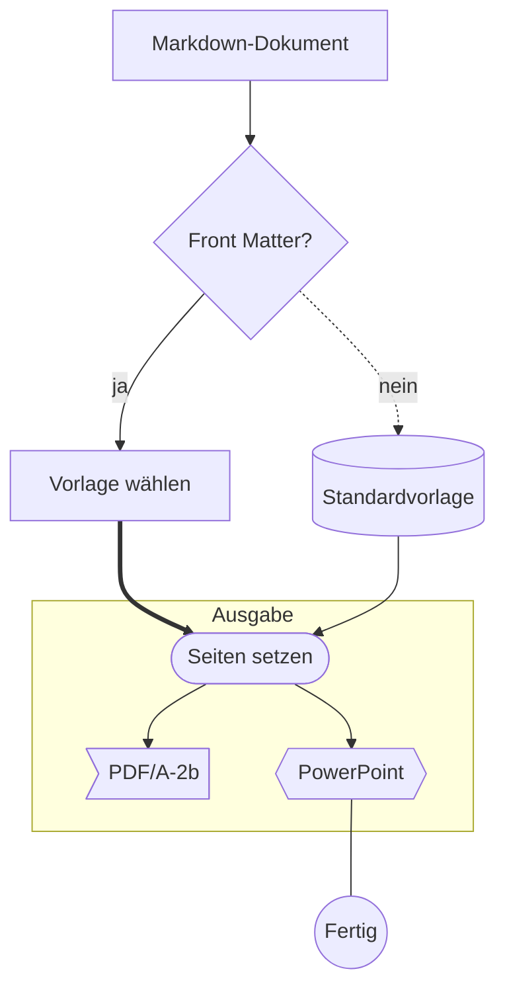
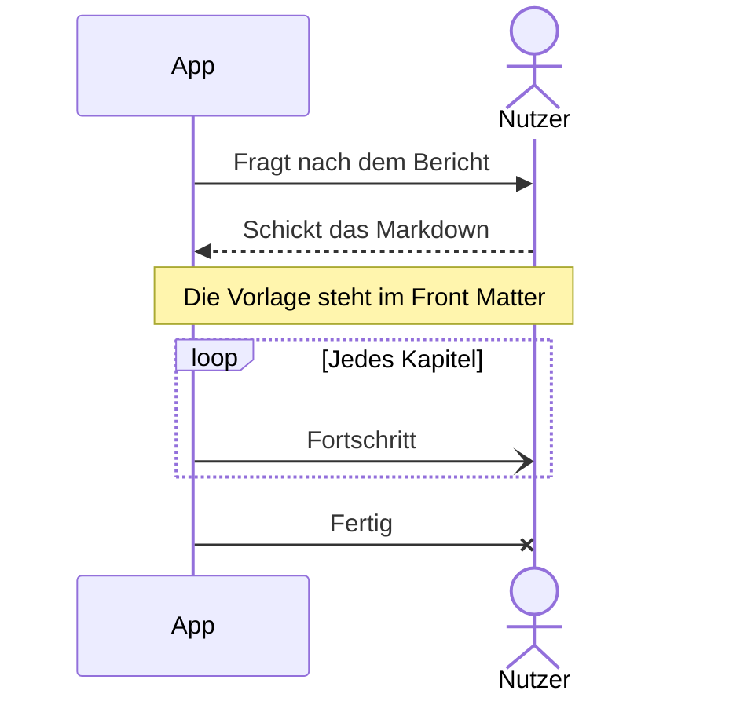
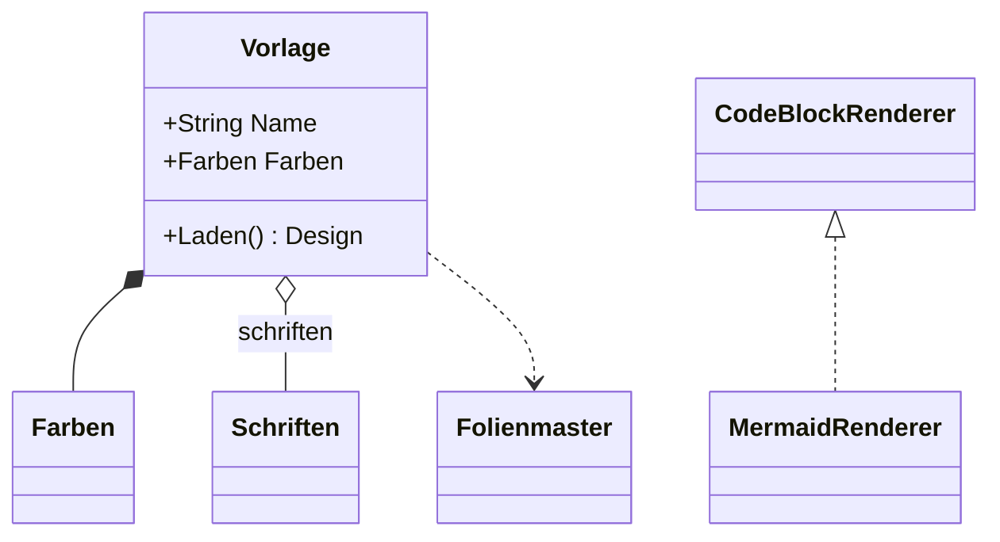
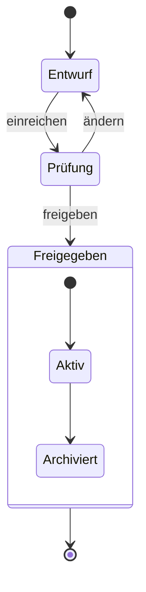
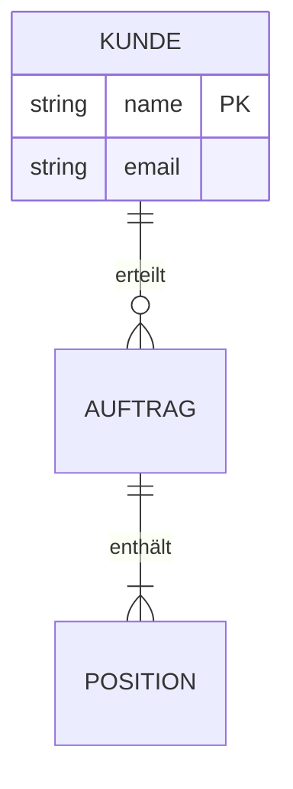
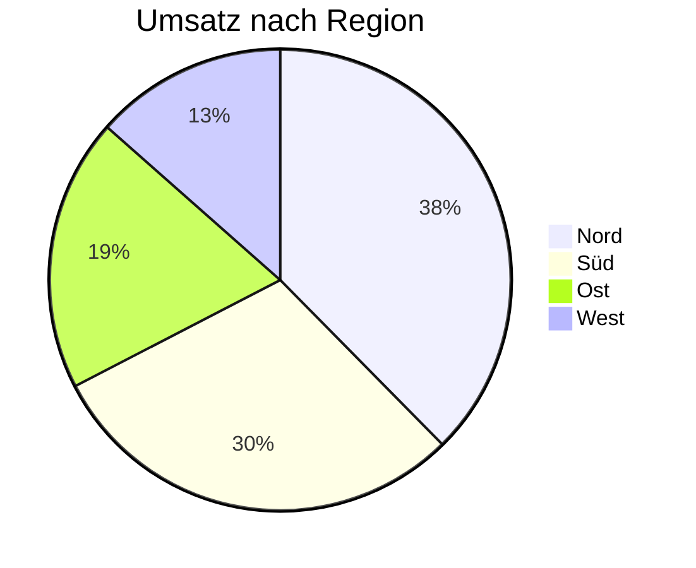
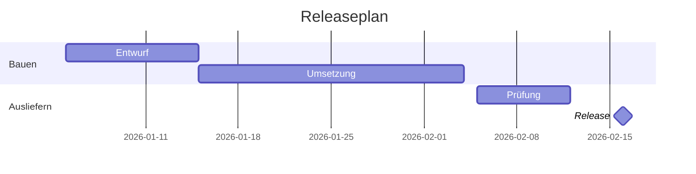
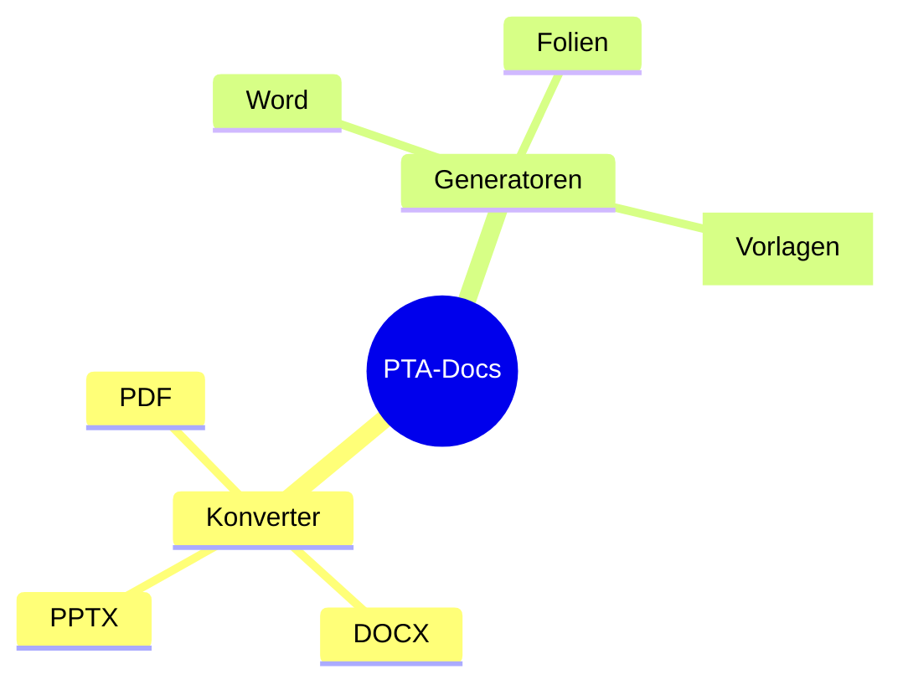

# Mermaid-Diagramme

## Ablauf (flowchart)


:::: notes
````markdown
## Ablauf (flowchart)


````
::::

## Sequenz (sequenceDiagram)



:::: notes
````markdown
## Sequenz (sequenceDiagram)


````
::::

## Klassen (classDiagram)



:::: notes
````markdown
## Klassen (classDiagram)


````
::::

## Zustände (stateDiagram-v2)



:::: notes
````markdown
## Zustände (stateDiagram-v2)


````
::::

## Datenmodell (erDiagram)



:::: notes
````markdown
## Datenmodell (erDiagram)


````
::::

## Anteile (pie)



:::: notes
````markdown
## Anteile (pie)


````
::::

## Plan (gantt)



:::: notes
````markdown
## Plan (gantt)


````
::::

## Mindmap (mindmap)



:::: notes
````markdown
## Mindmap (mindmap)


````
::::
