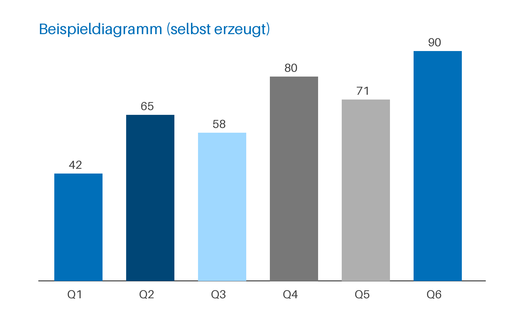

# Landscape without cover

Title and subtitle are in the header, the footer reads "As of" and "Page", the company line is
taken from `firma`.

| Variant | Cover | Format |
| :------ | :---: | :----- |
| `hoch` | yes | A4 portrait |
| `hoch-ohne-deckblatt` | no | A4 portrait |
| `quer` | yes | A4 landscape |
| `quer-ohne-deckblatt` | no | A4 landscape |

Table: The four Word variants

