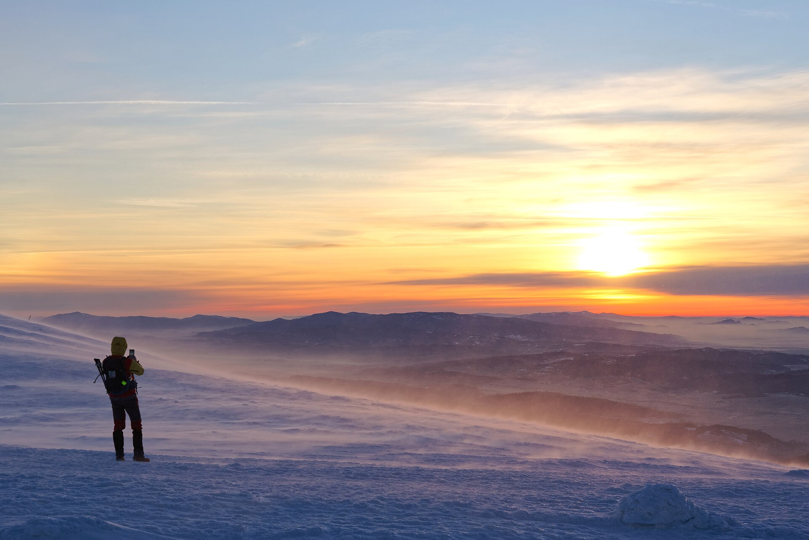
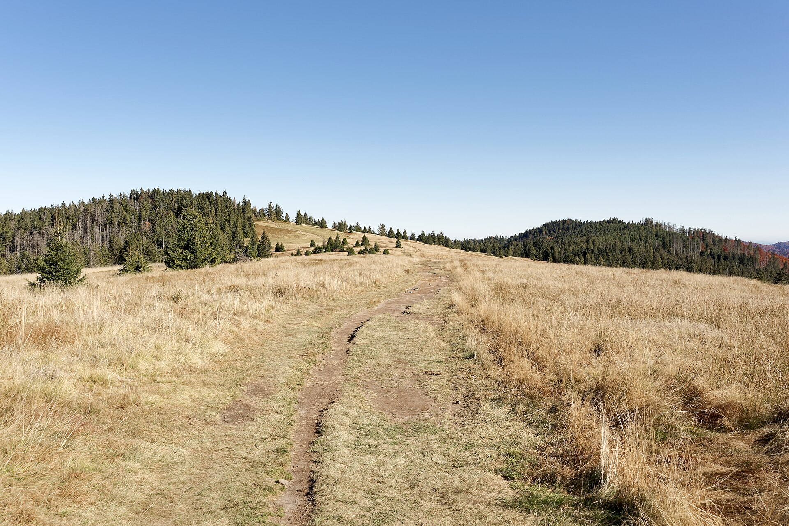
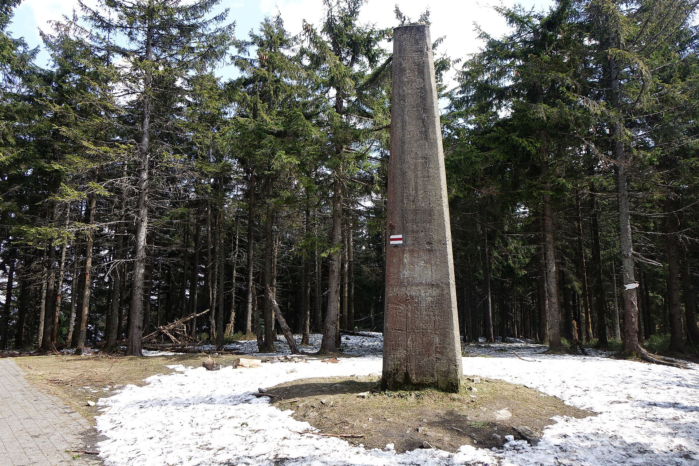
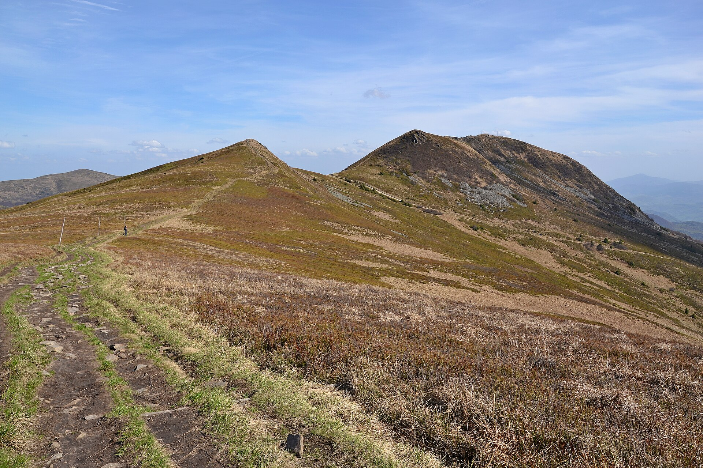

# Der Hauptbeskidenweg (GSB)

# Überblick

## Der Weg in Zahlen

- Rund **500 km**, durchgehend **rot** markiert
- Von **Ustroń** (Schlesischer Beskid) nach **Wołosate** (Bieszczady)
- Höchster Punkt: **Babia Góra**, 1725 m
- Sechs Gebirgsgruppen, drei bis vier Wochen zu Fuß

### Benannt nach Kazimierz Sosnowski

Er plante den westlichen Teil, der 1929 fertig wurde.

## Geschichte

1. 1929: westlicher Abschnitt Ustroń – Krynica
2. 1935: östlicher Abschnitt bis an die rumänische Grenze, über 800 km
3. Nach 1945: Verkürzung auf die heutigen Grenzen Polens
4. 2021: Gründung des Vereins zum Weg

# Die Abschnitte

## Gebirgsgruppen

| Abschnitt | Wichtige Gipfel | Höchster Punkt |
| :-------- | :-------------- | -------------: |
| Schlesischer Beskid | Stożek, Barania Góra | 1220 m |
| Saybuscher Beskid | Babia Góra, Polica | 1725 m |
| Gorce | Turbacz, Lubań | 1310 m |
| Sandezer Beskid | Przehyba, Radziejowa, Jaworzyna Krynicka | 1266 m |
| Niederer Beskid | Rotunda, Cergowa | – |
| Bieszczady | Chryszczata, Smerek, Halicz | 1333 m |

## Babia Góra

Der höchste Punkt des Weges, 1725 m. Wind und Nebel kommen hier schnell.

Foto: Jakub Hałun, CC BY-SA 4.0

## Gorce und Sandezer Beskid

 

Fotos: Jakub Hałun, CC BY 4.0; Jerzy Opioła, CC BY-SA 4.0

## Bieszczady

Almen (*połoniny*), Smerek und Halicz – das Ziel Wołosate liegt am Dreiländereck.

Foto: Pudelek, CC BY-SA 4.0

# Planung

## Unterwegs

- Unterkunft in Berghütten (*schroniska*), Pensionen oder im Zelt
- Regenschutz einpacken – das Wetter wechselt schnell
- Wegverlauf offline mitnehmen
  - mapa-turystyczna.pl
  - Waymarked Trails
- Im Osten lange Strecken ohne Einkaufsmöglichkeit

# Gute Wanderung! {.closing}
