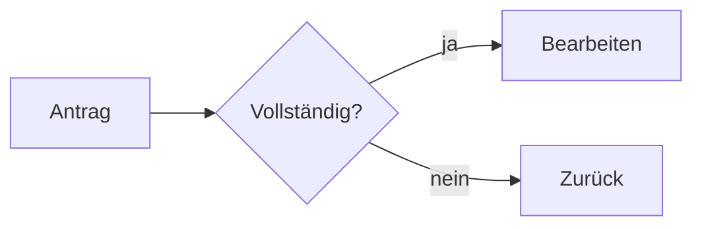

## Ein PTA-Word-Dokument aus Markdown

Inhalt schreiben, nicht formatieren: Schrift, Farben, Nummern, Kopf- und Fußzeile kommen aus der
PTA-Vorlage. Kein HTML.

`vorlage:` wählt die PTA-Vorlage:

- `hoch` (Standard): Hochformat mit Deckblatt; `titel:` ist Pflicht.
- `hoch-ohne-deckblatt`: Hochformat ohne Deckblatt; Titel und Untertitel in der Kopfzeile.
- `quer`: Querformat mit Deckblatt; `titel:` ist Pflicht.
- `quer-ohne-deckblatt`: Querformat ohne Deckblatt; Titel und Untertitel in der Kopfzeile.

## Gliederung

- `#`, `##`, `###` werden „Überschrift 1–3“ mit den Nummern `1`, `1.1`, `1.1.1`; `####` und
  tiefer „Zwischenüberschrift“ ohne Nummer. Keine Nummern selbst schreiben.
- Der Titel kommt aus `titel:`, nie aus `#`: das erste `#` ist Kapitel 1.
- `# Glossar {.appendix}` am ersten Anhangskapitel: ab dort heißen die Kapitel A, B, C.

## Inhalte

| Markdown | In Word |
| -------- | ------- |
| Absatz; `\` am Zeilenende bricht um | „Standard“ |
| Absatz nur aus `**fett**` | „Standard fett“ |
| `**fett**`, `*kursiv*`, `~~weg~~`, `` `Code` `` | Zeichenformat |
| `-`, `1.` (bis drei Ebenen), `- [x]`, `Begriff` mit `: Erklärung` darunter | Liste, Aufgaben, Definition |
| Tabelle, direkt davor ein Absatz `**Titel**`, direkt danach `Tabelle: …` | Tabelle „PTA“ mit Titel und „Tabelle n: …“ |
| Tabellenzelle genau `[3/4]` (`0` bis `4`) | Harvey Ball |
| Bild allein im Absatz `` | „Abbildung n: Titel“ (sonst Alt-Text) |
| mehrere Bilder in einem Absatz | nebeneinander, höchstens vier je Zeile |
| `` | QR-Code in PTA-Blau, ohne Bilddatei |
| `{.round}`, `{.grey}` oder `{scale=0.5}` direkt nach dem Bild | rund, grau, halb so groß |
| Codeblock, `> Zitat`, `---` | „Code“, „Zitat“, Trennlinie |
| `Satz.[^1]` und `[^1]: Text` | Word-Fußnote |
| `[PTA](https://pta.de)` | Link; relative Links bleiben Text |

Bildformate: PNG, JPEG, GIF, BMP, TIFF, SVG. Die Dateien gibt der Aufrufer mit; `images/a.png` muss darunter
sein.

## Folien-Syntax

Word, PowerPoint und PDF lesen dieselbe Syntax und prüfen sie, bevor sie schreiben: ein Fehler bricht mit der Zeile ab (`Line 12: …`) und nennt die gültigen Namen. Klammern, die nicht genau so aussehen, bleiben Text.

Word zeigt sie schlicht: der Inhalt eines Containers nacheinander, `###` darin fett; Fazit, Kommentar und Alerts als Hinweisabsatz mit fetter Art („Fazit:“), `==…==` gelb, farbige Wörter und Status-Labels in der Statusfarbe. Zeitstrahl, Schrittfolge und Risikomatrix werden ein Bild, der Projektplan eine Tabelle.

### Container

Ein Container beginnt mit einer Zeile `::: <name>` (Argumente dahinter) und endet mit `:::`; ineinander stehen sie mit längeren Zäunen (`::::` außen).

| Container | Wofür |
| --------- | ----- |
| `::: cards` | Karten nebeneinander: je Karte `### Titel` und ein kurzer Text, oder eine Liste `- **Titel** – Text`; ein erster Absatz `**26 %**` ist die Kennzahl der Karte. |
| `::: rows` | Zeilen aus einer Liste `- **Begriff** – Beschreibung`. |
| `::: panel` | Eine Fläche um den Inhalt; `::: panel dark` dunkel. |
| `::: statement` | Eine Aussage: der erste Absatz groß und fett, der Rest normal. |
| `::: columns` | Spalten, getrennt durch `---` mit einer Leerzeile davor; `::: columns 1:2` oder `1:1:2` gibt die Breiten vor. |
| `::: conclusion` | Die PTA-Fazit-Box: nur Text, höchstens zwei Zeilen, einmal je Folie, nicht in einem anderen Container. |
| `::: comment` | Die PTA-Kommentarbox zum Block direkt davor; nur Text. |
| `::: timeline` | Ein Zeitstrahl aus einer Liste `- 2026-Q2: Text` (2 bis 8 Einträge, aufsteigend; Termine `2026`, `2026-03`, `2026-Q2`, `2026-03-15`, `15.03.2026` oder `heute`; `{.done}` am Ende eines Eintrags heißt erledigt). |
| `::: gantt` | Ein Projektplan aus einer Tabelle mit den Spalten Vorgang, Start, Ende und Wer (freiwillig), 1 bis 12 Zeilen, Start = Ende ist ein Meilenstein; `::: gantt raster=monat` (`woche`, `monat`, `quartal`) nur bei Bedarf. |
| `::: steps` | Eine Schrittfolge: 3 bis 6 Schritte, je `### Titel` und höchstens ein kurzer Absatz; `{.current}` an höchstens einem `###` hebt den aktuellen hervor. |
| `::: riskmatrix` | Eine Risikomatrix aus einer Tabelle mit den Spalten Nr, Risiko, Wahrscheinlichkeit, Auswirkung (Werte 1 bis 5) und Maßnahme (freiwillig); `::: riskmatrix green=4 yellow=12` verschiebt die Schwellen der Farben. |
| `::: internal` | Nur in den Fassungen `intern` und `trainer`: Preise, Bemerkungen. |
| `::: exercise` | Eine Aufgabe; steht in jeder Fassung. |
| `::: solution` | Die Lösung der Aufgabe davor (direkt nach oder in ihrem `::: exercise`), nur in der Fassung `trainer`. |

Word lässt `notes` und `scene` weg (mit Hinweis).

### Hinweise und Hervorhebungen

- Ein Zitat, dessen erste Zeile ein Alert ist, wird ein Hinweis: `> [!NOTE]` (Hinweis), `> [!TIP]` (Tipp), `> [!IMPORTANT]` (Wichtig), `> [!WARNING]` (Warnung), `> [!CAUTION]` (Vorsicht).
- `==Text==` markiert wie ein Textmarker; ist die erste Zelle einer Tabellenzeile ganz markiert, die ganze Zeile.
- `[Wörter]{.success}` setzt Wörter fett in einer Statusfarbe: `{.success}` (Erfolg, im Plan), `{.warning}` (Warnung, kritisch), `{.danger}` (Gefahr, verfehlt), `{.info}` (Information), `{.neutral}` (neutral, offen). Signalfarben nur für Status, zur Hervorhebung `==…==`.
- Status-Labels: `status.success: Erledigt; Fertig` im Front Matter und eine Tabellenzelle nur aus `` `Erledigt` `` ergeben ein Label in der Farbe.

### Attribute an Überschriften

Am Ende einer Überschrift, in geschweiften Klammern; mehrere in einer Klammer durch Leerzeichen getrennt.

| Attribut | An | Wirkung |
| -------- | -- | ------- |
| `{.internal}` | `#`, `##` | Folie oder Kapitel nur in den Fassungen `intern`/`trainer`. |
| `{.appendix}` | `#` | Einmal, am ersten Anhangskapitel: ab dort heißen die Kapitel A, B, C. |

Die übrigen (`.closing`, `.dark`, `kicker="…"`, `layout="…"`, `uebergang="…"`, `.agenda`, `.interim`, `.quote`, `.contact`, `.backup`, `dauer=…` und `.break`) gelten nur für Folien: Word nimmt sie an, die Überschrift bleibt eine gewöhnliche Überschrift.

### Blockmarker

Eine Zeile nur aus dem Marker, direkt vor dem Block (Absatz, Liste, Tabelle, Container):

- `{.internal}`: Der Block steht nur in den Fassungen `intern` und `trainer`.

Word und PDF lassen `.build`, `.frag`, `.exit` und `.emphasize` weg.

## Icons

`:icon-check:` setzt ein Strich-Icon in PTA-Blau — keine Bilddatei, keine Quelle nötig. Im Text so hoch wie die Schrift; beginnt **jeder** Punkt einer Liste mit einem Icon, wird es das Aufzählungszeichen. Nur diese Namen; ein anderer ist ein Fehler, der ähnliche nennt:

`access-point` `adjustments` `alert-circle` `alert-triangle` `api` `arrow-down` `arrow-left` `arrow-right` `arrow-up` `arrows-exchange` `award` `ban` `bell` `bolt` `book` `brain` `briefcase` `bug` `building` `building-community` `bulb` `calculator` `calendar` `calendar-event` `cash` `certificate` `chart-bar` `chart-dots` `chart-line` `chart-pie` `check` `checklist` `circle-check` `circle-x` `clipboard-check` `clipboard-list` `clock` `cloud` `cloud-download` `cloud-upload` `code` `coin` `compass` `components` `copyright` `cpu` `currency-euro` `database` `device-desktop` `device-laptop` `device-mobile` `download` `edit` `eye` `file` `file-check` `file-text` `files` `filter` `flag` `flame` `flask` `folder` `folder-open` `gavel` `git-branch` `git-merge` `globe` `hand-stop` `headset` `heart` `heart-handshake` `help-circle` `hierarchy` `hierarchy-2` `home` `hourglass` `id-badge-2` `infinity` `info-circle` `key` `layers-intersect` `layout-dashboard` `leaf` `license` `lifebuoy` `link` `list-check` `loader` `lock` `lock-open` `mail` `map` `map-pin` `message` `message-circle` `messages` `microscope` `minus` `mood-sad` `mood-smile` `network` `notebook` `package` `pencil` `percentage` `phone` `player-pause` `player-play` `plug` `plus` `presentation` `printer` `progress` `puzzle` `receipt` `recycle` `refresh` `repeat` `report-analytics` `report-money` `robot` `rocket` `rotate` `route` `scale` `school` `search` `server` `server-2` `settings` `share` `shield` `shield-check` `shopping-cart` `sitemap` `sort-ascending` `sparkles` `square-check` `star` `target` `target-arrow` `terminal-2` `test-pipe` `thumb-down` `thumb-up` `tool` `tools` `trash` `trending-down` `trending-up` `truck` `upload` `user` `user-check` `users` `users-group` `wifi` `world` `writing` `x` `zoom-check`

## Typografie und Code

Gerade Anführungszeichen (`"…"`, `'…'`), ` - ` und `...` schreiben: der Generator setzt „…“, ‚…‘, – und … und schützt Leerzeichen in `z. B.`, `Nr. 3`, `10 %`. Code, Links und Front Matter bleiben unberührt; `typografie: nein` schaltet es ab. Codeblöcke mit Sprache (```` ```python ````) werden farbig (`syntaxhervorhebung: nein` schaltet ab); eine unbekannte Sprache ergibt den Hinweis `code-language-unknown`.

## Charts

Ein Codeblock mit der Sprache `chart` wird ein Balken-, Linien- oder Flächendiagramm in den
PTA-Farben — in Word und PowerPoint ein echtes Diagramm, dessen Daten sich mit „Daten
bearbeiten" ändern lassen. Oben stehen die Einstellungen, je Zeile `name: wert`, dann eine
Zeile `---`, dann die Daten als CSV: eine Kopfzeile (der Name der Kategorienspalte, dann ein
Name je Reihe) und eine Zeile je Kategorie.

````markdown
```chart
type: bar
title: Aufträge je Monat
unit: Tsd. EUR
source: Quelle: Vertrieb
---
Monat, Plan, Ist
Jan, 120, 132
Feb, 118, 121
Mär, 125, 140
```
````

- **Einstellungen** (englisch, alle freiwillig): `type` ist `bar` (Balken, Standard), `line`
  (Linien) oder `area` (Flächen); `stacked: true` stapelt Balken oder Flächen (Linien nie);
  `title`, `unit` (Einheit der Werte) und `source` (Quellenangabe). Ein Kommentar steht nach
  ` # `. Ohne Einstellungen besteht der Block nur aus der CSV.
- **Zahlen:** Mit `,` als Trennzeichen haben Zahlen einen Dezimalpunkt (`1250.5`), mit `;` ein
  Dezimalkomma (`1250,5`) — die Kopfzeile entscheidet. Keine Tausenderpunkte. Ein Feld in
  Anführungszeichen darf das Trennzeichen enthalten; ein leeres Feld lässt eine Lücke.
- **Folien:** Ein Chart allein kommt auf `Titel und Diagramm`, mit Text davor auf
  `Titel, Text und Diagramm`, mit Text danach auf `Titel, Diagramm und Text`; zwei Charts
  (auch in `::: columns`) auf `Titel und zwei Diagramme`. Titel, Einheit und Quelle stehen in
  den Platzhaltern des Layouts. Auf Folien mit Hinweisboxen, Karten o. Ä. ist ein Chart ein
  Fehler.
- **Word:** Das Diagramm steht über die Satzspiegelbreite (höchstens 5:8 so hoch), mit einem
  Titel darunter die Beschriftung „Abbildung n: Titel". Ein Absatz `Abbildung: …` direkt nach
  dem Block geht dem Titel vor.
- Ein Fehler in Einstellungen oder Daten bricht mit der Zeile ab, in der er steht.

### Finanzdiagramme

Ein Codeblock mit der Sprache `financial-chart` enthält eines der Diagramme einer
Ergebnisübersicht als JSON: `development` (Entwicklung über das Jahr), `growth-by-row`
(Wachstum je Zeile), `actual-vs-reference` (Ist gegen Plan), `growth-trend` (Wachstumstrend),
`two-year` (zwei Jahre Monat für Monat) oder `summary-table` (Übersichtstabelle). Die Schlüssel
sind englisch, weil solche Blöcke meist ein Programm schreibt. Wachstumsraten und Anteile sind
Brüche (`0.05` sind 5 %), `lastActual` zählt die Monate ab 0.

````markdown
```financial-chart
{
  "type": "growth-trend",
  "title": "Wachstum Aufträge",
  "period": "Mai 2026",
  "lastActual": 2,
  "reference": 0.05,
  "months": [
    { "label": "Jan", "change": 0.056 }, { "label": "Feb", "change": 0.054 },
    { "label": "Mär", "change": 0.04 }, { "label": "Apr", "change": 0.045 },
    { "label": "Mai", "change": 0.05 }
  ],
  "options": { "labels": { "reference": "Ziel" } }
}
```
````

- **Sprache:** Zahlen und Beschriftungen folgen `sprache:` (deutsch: `5,2 %`, *Vorjahr*, *Ist*,
  *Plan*, *Prognose*); `"culture": "en"` (oder `de`, `de-DE`, `en-US`, `en-GB`) stellt um.
- **Optionen** (`options`): `culture`, `scale` und `unit` (`1000000` und `Mio. EUR`), `labels`
  über denen der Sprache (`previous`, `current`, `reference`, `projection`, `estimate`,
  `change`, `overall`, `value`), `tolerance` (ab wann eine Zahl vorn oder hinten liegt, Standard
  `0.005`), `restShare` und `width` (Breite in Pixeln, Standard 560).
- **Regeln:** Eine Farbe bedeutet eine Reihe, Grün und Rot stehen nur an Zahlen, gestrichelt
  heißt Prognose, jede Werteachse enthält null.
- **Folien:** Das Diagramm steht als Gruppe bearbeitbarer Formen in der Inhaltsfläche von
  `Nur Titel` (mit Text davor auf `Titel und Text`), nie größer als gezeichnet.
- **Word:** Das Diagramm steht als Bild (scharf als SVG, mit PNG für ältere Word-Versionen) in
  seiner natürlichen Größe, höchstens über die Satzspiegelbreite; ein Absatz `Abbildung: …`
  direkt nach dem Block wird die Beschriftung „Abbildung n: …". Dafür braucht es das Extra `svg`.
- Ein unbekannter Schlüssel, ein falscher Typ oder ungültiges JSON bricht mit der Zeile ab;
  Kommentare (`//`) und ein Komma nach dem letzten Eintrag sind erlaubt.

## Diagramme

Ein Codeblock mit der Sprache `mermaid` wird ein Diagramm in den PTA-Farben — auf Folien als
Gruppe bearbeitbarer Formen. Diagramme nur dort, wo ein Bild mehr sagt als Aufzählungen: ein
Ablauf, eine Abfolge von Aufrufen, ein Datenmodell, ein Plan.

````markdown

````

- **Gezeichnet:** `flowchart` (oder `graph`, mit `subgraph`), `sequenceDiagram`,
  `classDiagram`, `stateDiagram-v2`, `erDiagram`, `pie`, `gantt`, `mindmap`.
- **Nicht gezeichnet:** jede andere Art (`journey`, `timeline`, `gitGraph`, C4, …) bleibt ein
  Codeblock. Nicht verwenden.
- Diagramme klein halten: bis etwa zwölf Knoten, kurze Beschriftungen. Ein breites Diagramm wird
  samt Schrift verkleinert und schwer lesbar.
- Farben kommen aus dem Design; `classDef`, `style` und Symbole besser weglassen.
- **Word:** Das Diagramm steht als Bild (scharf als SVG, mit PNG für ältere Word-Versionen)
  in seiner natürlichen Größe, höchstens über die Satzspiegelbreite. Ein Absatz
  `Abbildung: …` direkt nach dem Block wird die Beschriftung „Abbildung n: …".
- Ein Diagramm mit Syntaxfehler bricht mit der Zeile seines Blocks und der Meldung von Mermaid ab.

## Front Matter

Einstellungen stehen in einem Block ganz oben, vor allem anderen, zwischen zwei Zeilen `---`: je Zeile `schlüssel: wert`, ohne Verschachtelung und ohne Listen. Schlüssel und Werte sind deutsch, Wahrheitswerte `ja` oder `nein`. Was der Standard schon tut, weglassen.

```markdown
---
titel: Netzausbau 2027
untertitel: Zwischenbericht
autor: Erika Mustermann
datum: 2026-05-15
vorlage: quer
---
```

| Schlüssel | Werte | Bedeutung |
| --------- | ----- | --------- |
| `vorlage` | `hoch` (Standard), `hoch-ohne-deckblatt`, `quer`, `quer-ohne-deckblatt` | Die PTA-Vorlage, siehe oben. |
| `titel` | Text | Der Titel auf dem Deckblatt und in der Kopfzeile. |
| `untertitel` | Text | Die Zeile unter dem Titel. |
| `autor` | Text | „Autor, Ort, Datum“ auf dem Deckblatt. |
| `ort` | Text | Der Ort darin. |
| `datum` | `2026-11-08` oder `08.11.2026` | Das Datum des Dokuments statt des heutigen. |
| `firma` | Text | Ersetzt „PTA IT-Beratung“ in der Fußzeile. |
| `sprache` | `de` (Standard), `en` | Die Sprache der erzeugten Texte („Seite“, „Tabelle“, Hinweisnamen). |
| `typografie` | `ja` (Standard), `nein` | Gerade Anführungszeichen, ` - ` und `...` werden „…“, – und …; `nein` lässt sie. |
| `syntaxhervorhebung` | `ja` (Standard), `nein` | Codeblöcke mit Sprache werden farbig; `nein`: einfarbig. |
| `pruefung` | `aus` oder `style-…`-Codes, durch Kommas getrennt | Nur `./run.sh check`: diese Stilregeln nicht prüfen. |
| `inhaltsverzeichnis` | `ja`, `nein` (Standard) | Ein Inhaltsverzeichnis vor Kapitel 1; Word füllt es beim Öffnen. |
| `kennzeichnung` | `vertraulich`, `intern`, `entwurf`, `kein` (Standard) | Text unter dem Logo jeder Seite und auf dem Deckblatt; `entwurf` dazu das Wasserzeichen „ENTWURF“. |
| `fassung` | `kunde` (Standard), `intern`, `trainer` | Die Fassung: `kunde` ohne Internes und Lösungen, `intern` mit Internem, `trainer` mit allem. |
| `status.<kategorie>` | Texte, durch `;` getrennt | Tabellenzellen nur aus einem dieser Texte als Code (`` `Erledigt` ``) werden Status-Labels in der Farbe der Kategorie: `success` (Erfolg, im Plan), `warning` (Warnung, kritisch), `danger` (Gefahr, verfehlt), `info` (Information), `neutral` (neutral, offen). Jeder Text gehört zu einer Kategorie. |

Ein unbekannter Schlüssel, ein doppelter oder ein ungültiger Wert ist ein Fehler, der die gültigen nennt.

## Wenn etwas falsch ist

Ein Fehler bricht ab und sagt (englisch), was zu ändern ist:

- `vorlage: hoch` ohne `titel:` — `… has a cover page and needs a title`.
- `::: karte` — `Line 12: Unknown container '::: karte'. Valid containers: …`.
- Bilddatei fehlt — `The image 'images/a.png' (line 8) is not among the document's resources.`
- Bildformat ohne Konverter — `… DOCX takes PNG, JPEG, GIF, BMP and TIFF …`.

### Hinweise

Was der Generator umgehen musste, meldet er als Hinweis mit Zeile (`line 12: …`); das Dokument ist trotzdem geschrieben. Das Markdown so ändern, dass keine Hinweise mehr kommen.

| Code | Was tun |
| ---- | ------- |
| `image-enlarged` | Ein Bild wird mehr als doppelt so groß gezeigt, wie es Pixel hat, und wirkt unscharf. |
| `raw-html` | Rohes HTML wird weggelassen; Markdown schreiben. |
| `code-not-drawn` | Ein Diagramm- oder Chart-Block wurde nicht gezeichnet und steht als Code da. |
| `notes-dropped` | Sprechernotizen fallen weg. |
| `code-language-unknown` | Die Sprache eines Codeblocks ist unbekannt; er steht einfarbig da. |
| `image-scale-in-title` | `scale=N` im Bildtitel gehört als `{scale=N}` hinter das Bild. |
| `scene-dropped` | Eine Szene (`::: scene`) fällt weg. |
| `audience-omitted` | Die Fassung hat interne Blöcke oder Lösungen weggelassen — erwartet, kein Fehler. |
| `attribute-ignored` | Ein Überschriftenattribut des anderen Dokumenttyps (`{.backup}` in Word und PDF, `{.appendix}` auf Folien) bleibt ohne Wirkung. |
| `handout-without-pictures` | Nur `./run.sh handout`: das Handout zeigt den Text der Folien statt ihrer Bilder, weil die Vorschau fehlt — `./run.sh setup` installiert sie. |

## Beispiel

````markdown
---
titel: Statusbericht Netzausbau
untertitel: Stand Mai 2026
autor: Erika Mustermann
kennzeichnung: vertraulich
status.success: Erledigt
status.warning: Verzug
---
# Lage

Der Ausbau ist [im Plan]{.success}; ==ein Paket== braucht Hilfe.

**Arbeitspakete**

| Paket | Stand |
| ----- | ----- |
| Migration | `Erledigt` |
| Schnittstellen | `Verzug` |

Tabelle: Stand der Arbeitspakete

# Nächste Schritte


> [!NOTE]
> Die Abnahme ist am 15.06.2026.
````
