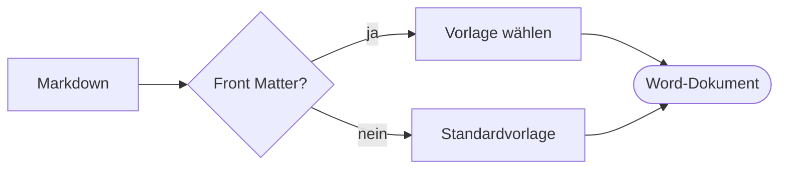
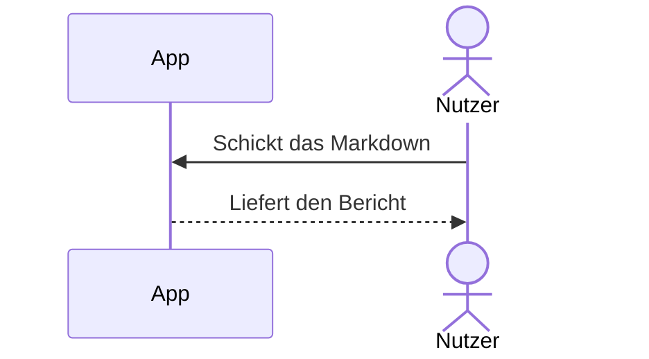
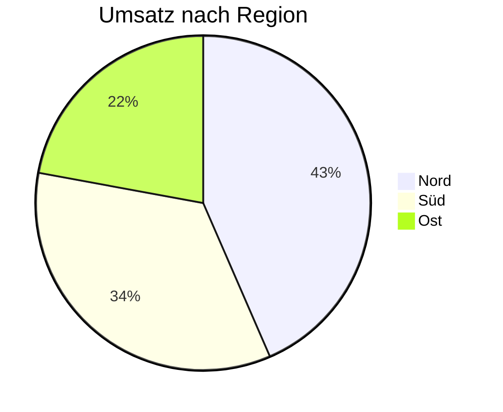

# Mermaid-Diagramme

Word: Mermaid-Diagramme als scharfe Abbildungen

PTA Documents, Hamburg, 08.11.2026

# Mermaid-Diagramme in Word

## Ablauf

Ein mermaid-Block steht in Word als Bild (SVG, mit PNG für ältere Word-Versionen) in seiner natürlichen Größe, höchstens über die Satzspiegelbreite; ein Absatz Abbildung: … direkt danach wird die Beschriftung:

````markdown


Abbildung: Vom Markdown zum Word-Dokument
````


Abbildung 1: Vom Markdown zum Word-Dokument

## Sequenz

Ohne Abbildung: … gibt es keine Beschriftung:

````markdown

````


## Anteile

````markdown


Abbildung: Umsatz nach Region
````


Abbildung 2: Umsatz nach Region
