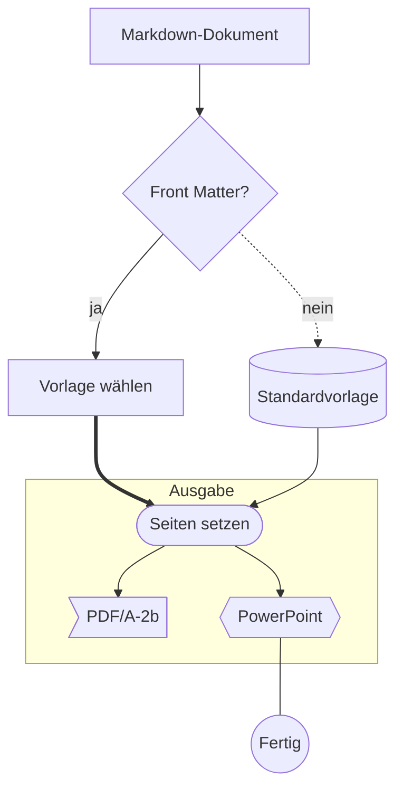
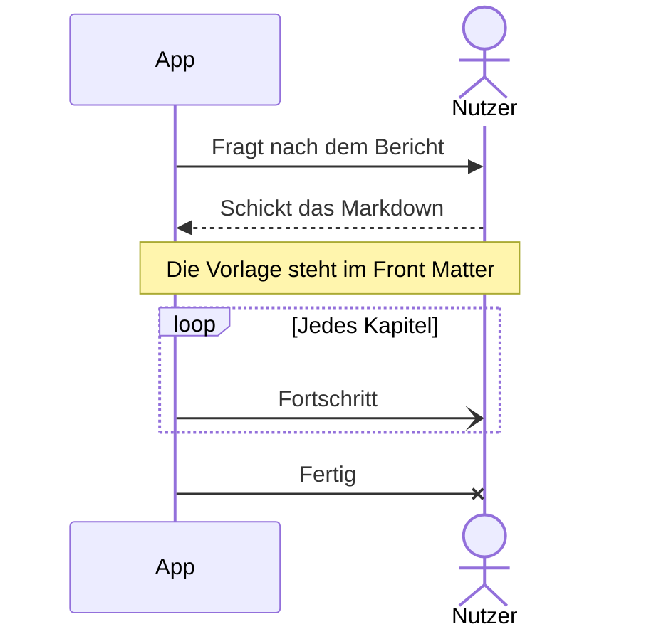
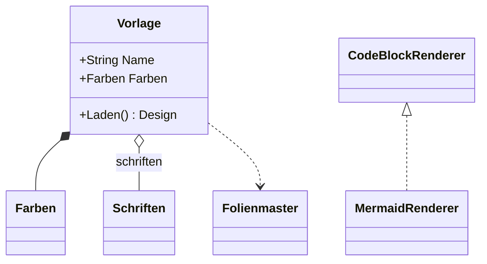
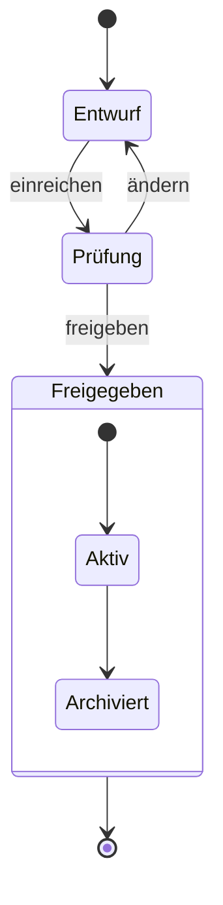
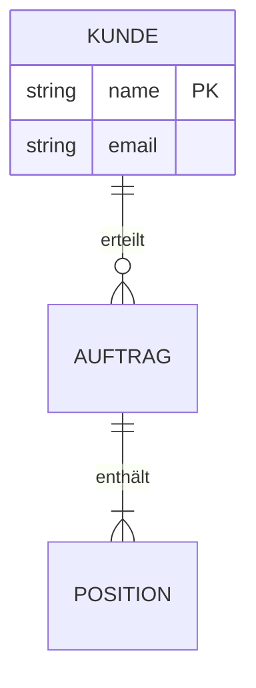
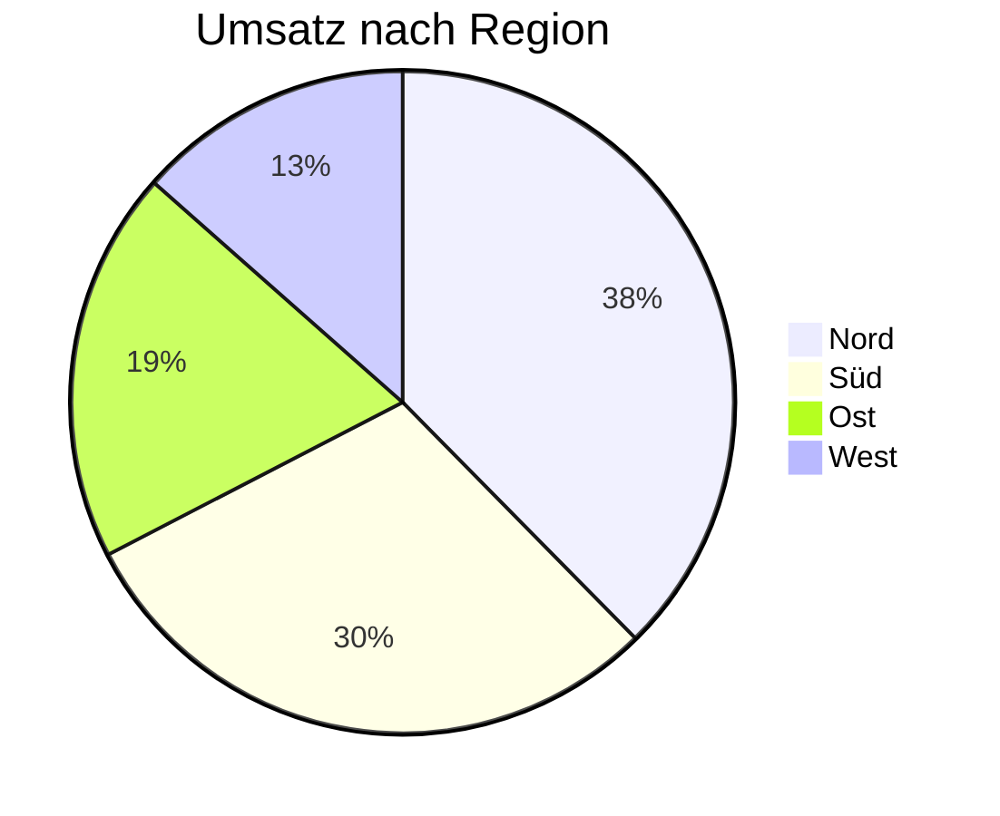
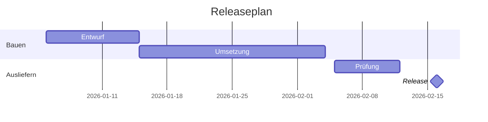
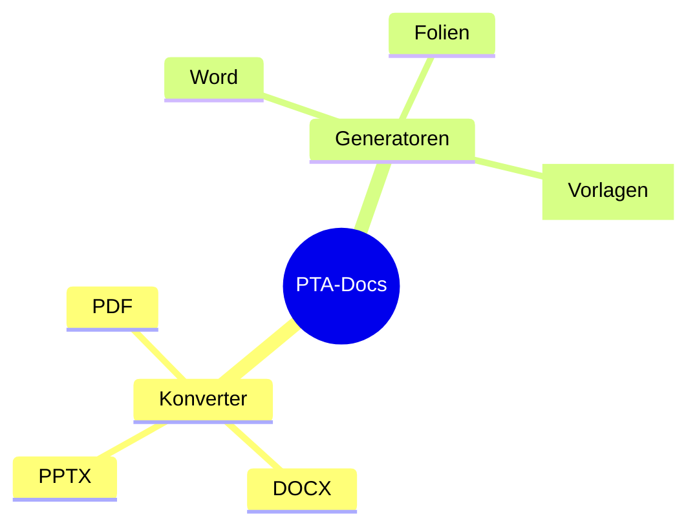

## Mermaid-Diagramme

PTA Documents, 08.11.2026

PowerPoint: jede Mermaid-Art als bearbeitbare Formen

## Ablauf (flowchart)

::: notes

````
## Ablauf (flowchart)


````

:::

## Sequenz (sequenceDiagram)

::: notes

````
## Sequenz (sequenceDiagram)


````

:::

## Klassen (classDiagram)

::: notes

````
## Klassen (classDiagram)


````

:::

## Zustände (stateDiagram-v2)

::: notes

````
## Zustände (stateDiagram-v2)


````

:::

## Datenmodell (erDiagram)

::: notes

````
## Datenmodell (erDiagram)


````

:::

## Anteile (pie)

::: notes

````
## Anteile (pie)


````

:::

## Plan (gantt)

::: notes

````
## Plan (gantt)


````

:::

## Mindmap (mindmap)

::: notes

````
## Mindmap (mindmap)


````

:::
